<p align="center"></p>

# Vibey Client

**One modular client mod for friends, cosmetics, emotes, world hosting and lyrics, in the Vibe look.**

Vibey Client is a Minecraft client mod for Fabric and NeoForge by Vibe Craft Studios. It replaces the title screen
and adds a menu in the black-and-purple Vibe design (with the grey seal mascot). You get friends, chats and world
invites on the Vibe backend, capes, wings, auras, pets, shields, hats and back items that other players can see, an
emote wheel with props, particles and sounds, and the *Vibey Multiplayer* and *Vibey Lyrics* mods built in as
modules. Every part is a module you can switch off. **Everything is free.** There is no shop and nothing to buy.


| Title screen | Wardrobe |
|---|---|
| 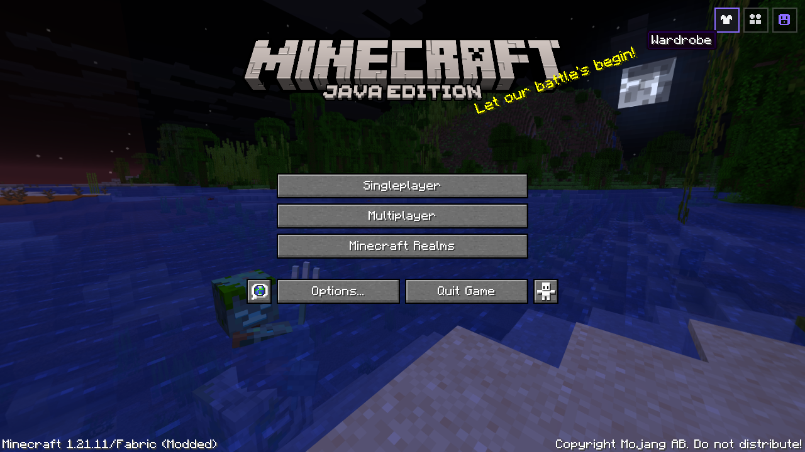 | 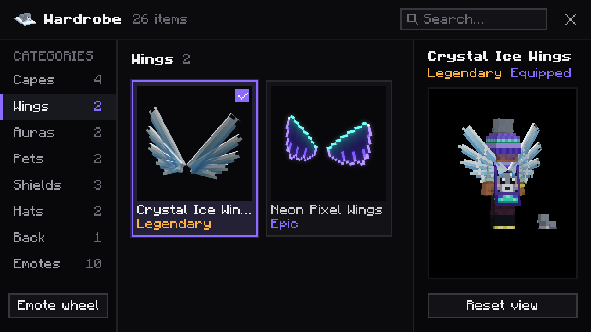 |
| **Cosmetics in game** | **Emote wheel (B)** |
| 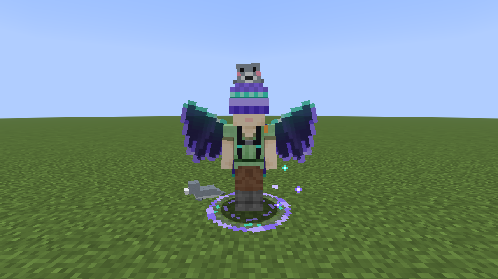 | 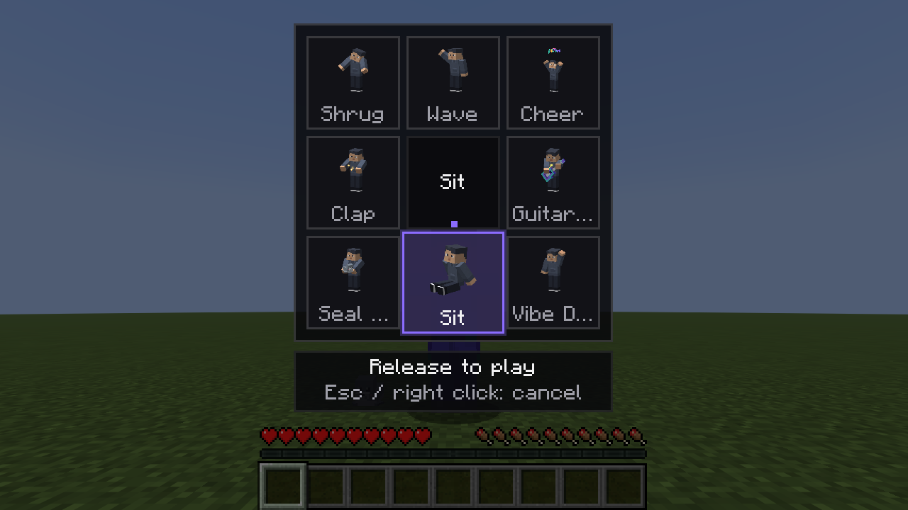 |
| **Friends sidebar (G) with an invite** | **Chat** |
| 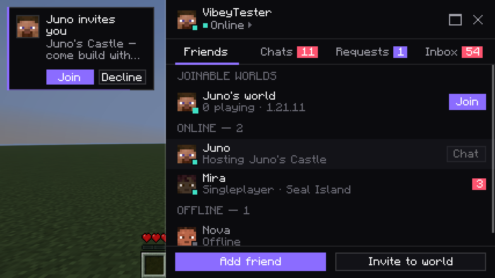 | 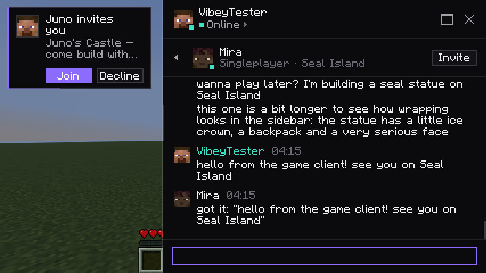 |
| **Guitar Jam emote (prop + note particles)** | **Seal Summon emote** |
| 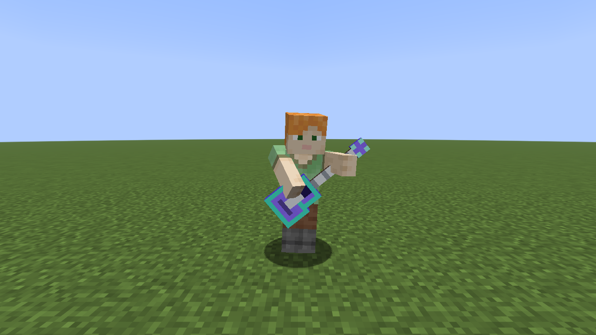 | 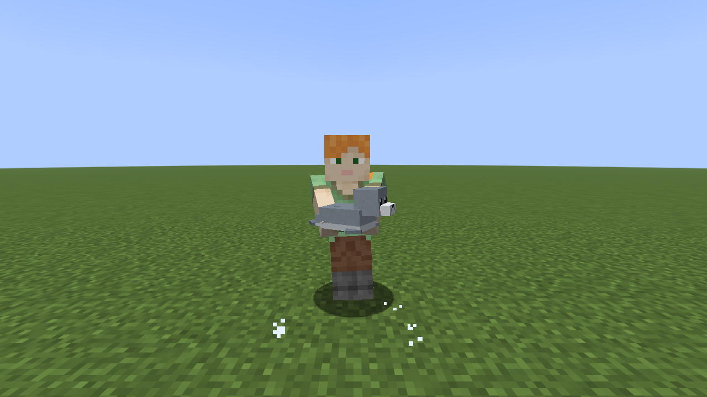 |
| **Host your world (multiplayer module)** | **Lyrics in the sky (lyrics module)** |
| 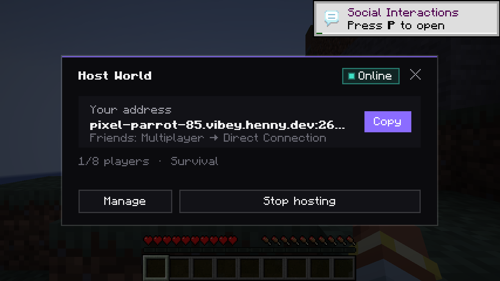 | 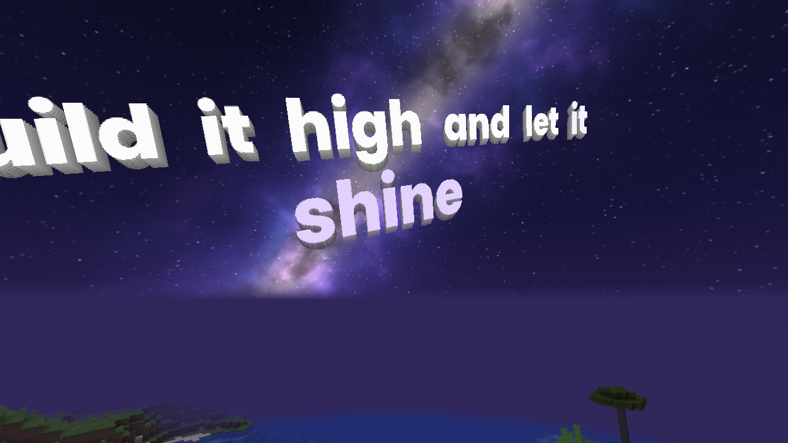 |
| **Vibey menu (Right Shift)** | **Blockbench plugin** |
| 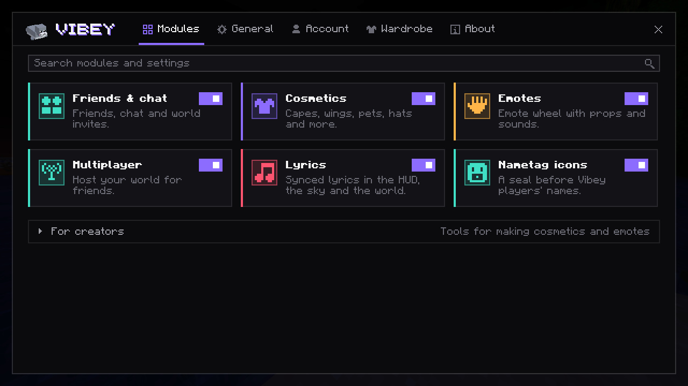 |  |

*Screenshots from the automated client tests (Fabric 1.21.11) and the real Blockbench. Social screenshots were taken
against a local test backend with bot accounts.*

## Features

### UI & menus

- **Vibey title screen:** singleplayer, multiplayer, wardrobe, friends and settings on the left, your own player
  with all equipped cosmetics on the right (drag to rotate; now and then it plays one of your emotes), the seal in
  the corner and on its ice floe when cosmetics are off, a status line with the client version and whether
  Vibe is online. *Vibey main menu* off (or *Classic menu*) gives you the vanilla title screen back, with a small
  Vibey button.
- **Welcome in three steps** on first start: language, online features on or off, the most important keys. You
  can open it again under *About*.
- **Vibey menu** (Right Shift, or *Vibey* in the pause menu): every module with an on/off switch and its settings,
  global settings, search (just start typing), Account and About tabs. Full keyboard use (Tab, Enter, Ctrl+Tab,
  Esc).
- **Pause menu row:** *Vibey*, *Wardrobe*, *Friends* under the vanilla buttons, and *Host World* in place of *Open to
  LAN*.
- **Toasts** for friend requests, messages, invites and friends coming online, top right, over every screen.
- **UI scale** for the Vibey screens (game / 2× / 3× / 4×), animations on or off, English and German (follows the
  game language or set it by hand).

| Welcome: online features | Pause menu |
|---|---|
| 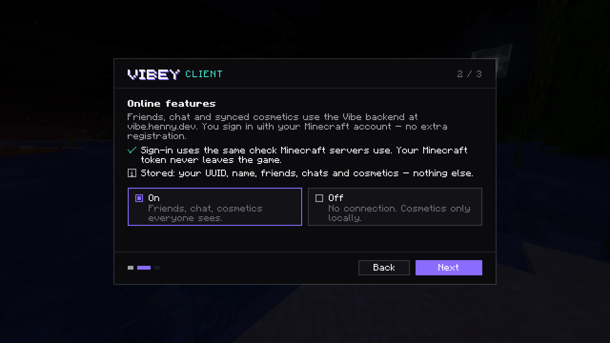 | 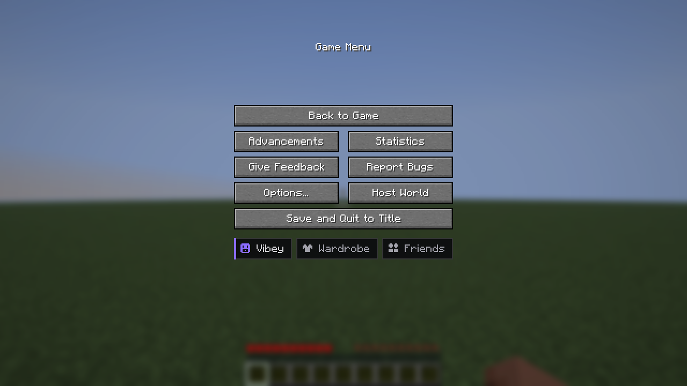 |

### Social

Friends on the Vibe backend, logged in with your Minecraft account (no extra registration, see
[Privacy](#privacy)).

- **Friends** with live status (online / away / busy / invisible, auto-away when the game is in the background) and
  what they are playing: singleplayer world, server, or a world they host.
- **Friend requests**, **direct chats** and **group chats** (name, members, leave), an **inbox** for everything
  else, **profiles**, **blocking** (always works both ways).
- **Invites into your world:** host your singleplayer world with the multiplayer module and invite friends with one
  click. They get a toast with *Join* / *Decline*; *Joinable worlds* at the top of the friends list.
- **Privacy settings:** who may send you friend requests, messages and invites (everyone, friends of friends,
  friends, nobody), whether friends see the worlds you host, hide the server address, do not disturb.
- **Account tab:** status text, logged-in devices (log any of them out), blocked players, log out.
- Sidebar on **G**, or full screen with the maximize button.
- **Nametag icons:** a small seal before the name of everyone who plays with Vibey Client (above their head and in
  the tab list), plus staff, supporter and creator badges. Module *Nametag icons*, with separate switches for the
  nametag, the tab list and the badges.

| Invite toast in game | Group chat |
|---|---|
| 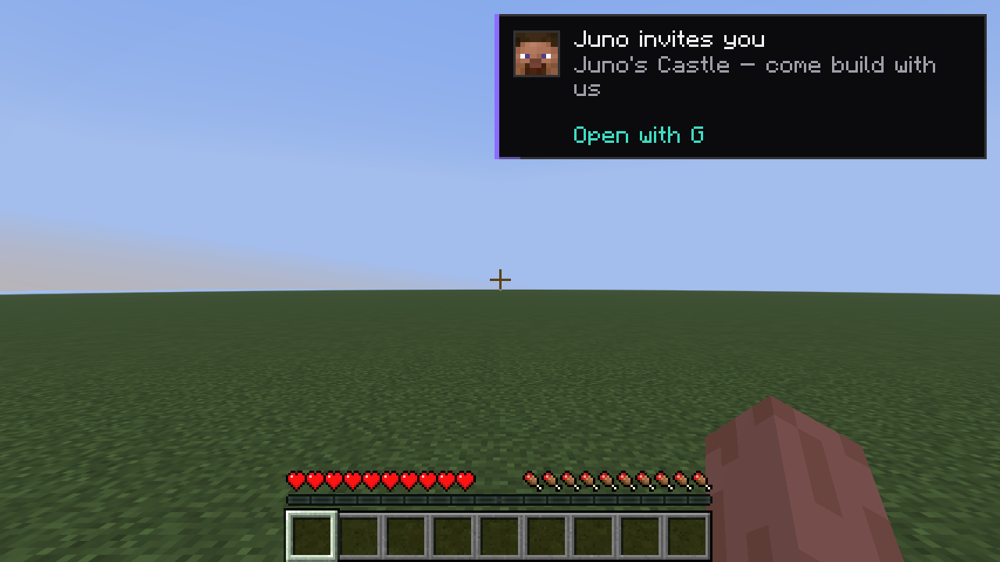 | 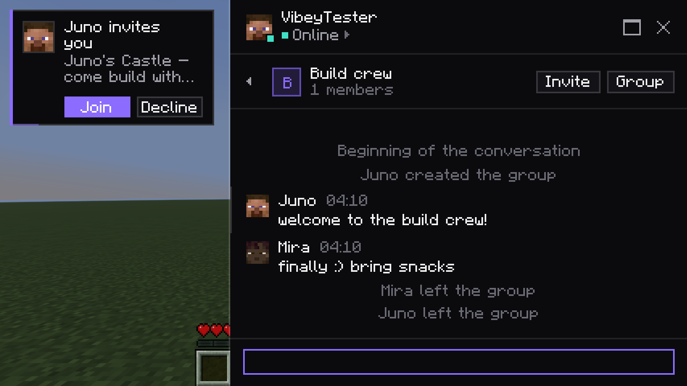 |

*A friend accepted the invite and joined the hosted world – their cosmetics and emotes show up for you:*

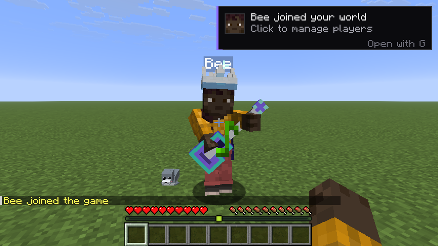

### Cosmetics

- **Seven slots:** cape, wings, aura, pet, shield, hat, back item. 16 cosmetics in the free starter set, e.g. the
  animated Aurora Cape, Crystal Ice Wings, a Snowflake Orbit aura, the Seal Buddy pet, the Seal Beanie and the Seal
  Backpack ([full list](docs/CONTENT.md#items)).
- **Wardrobe** (title screen, pause menu or the Vibey menu): categories, search, a 3D preview you can rotate,
  hover to try something on.
- **Other players see them:** through the Vibe backend on any server (even vanilla), and through the server
  channel when the server also runs Vibey Client. Cosmetics are animated (idle, walk, fly, sneak), can glow, carry
  particles, and pets follow you around.
- **Hidden under armor** where it makes sense (e.g. hats under helmets). Show or hide your own and other players'
  cosmetics, per slot.
- Works offline too: the starter set ships inside the jar.
- **New cosmetics arrive over the air:** no client update needed – new and updated items download in the background
  and show up in the wardrobe (with a short notice), equipped items stay equipped.

| Crystal Ice Wings + Ice Crown | Snowflake Orbit + Pixel Penguin |
|---|---|
| 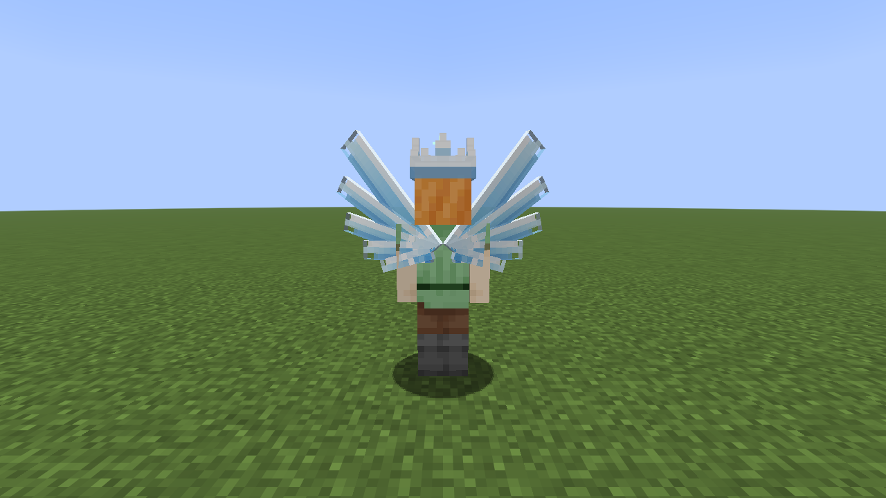 | 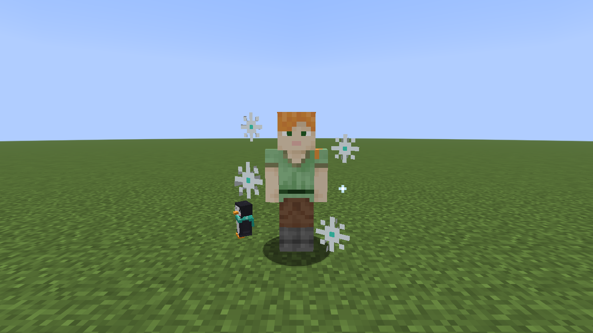 |

### Emotes

- **Emote wheel** on **B**: hold, point at an emote, release. Eight slots, assign them in the wardrobe
  (*Edit wheel*).
- 10 free emotes: Wave, Clap, Cheer, Vibe Dance, Facepalm, Sit, Seal Summon, Guitar Jam, Seal Flop, Shrug.
- **Props, particles and sounds:** a guitar in your hands, a seal that pops into your arms, confetti, notes,
  sparkles, sounds positioned at the player.
- Switches to third person while you emote (setting) and stops when you move. Other players see your emotes
  (backend or server channel); emote volume and "show emotes of others" are settings.

| Cheer | Emotes in the wardrobe |
|---|---|
| 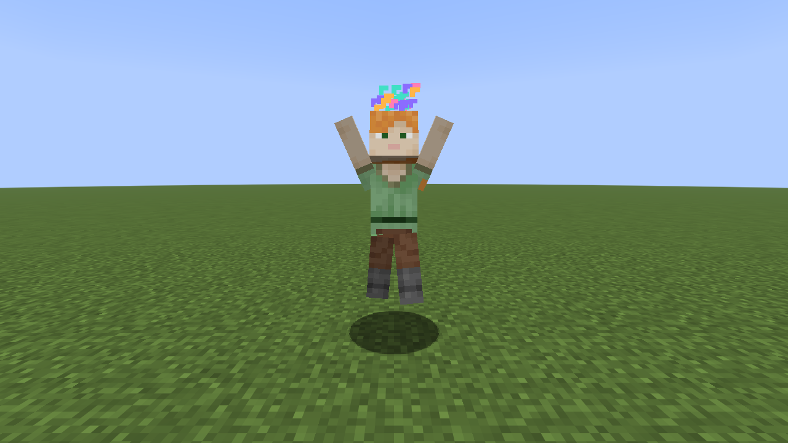 | 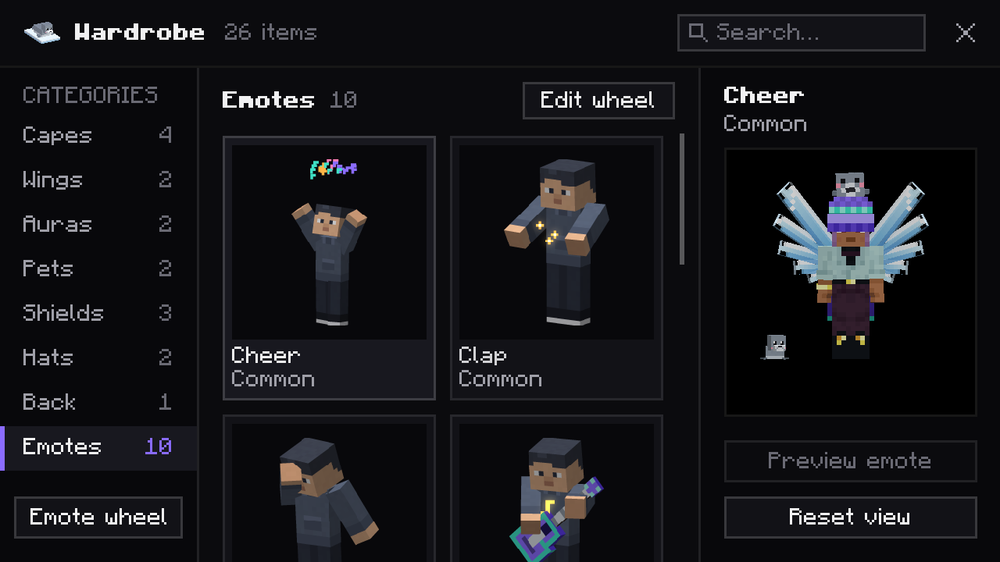 |

### Multiplayer module

The full [Vibey Multiplayer](https://github.com/vibec-studios/vibey-multiplayer) mod, built in: host your
singleplayer world for friends anywhere with **one fixed address**, no port forwarding, no server. *Host World* in
the pause menu, a *Manage* menu with players, whitelist and ban list (enforced by the relay), world settings and
*Force mods*. Friends join with a normal Minecraft through *Multiplayer → Direct Connection*, or with one click from
your invite.

### Lyrics module (Fabric)

The full [Vibey Lyrics](https://github.com/vibec-studios/vibey-lyrics) mod, built in: synced lyrics for your own
songs or for the music playing on your PC (Spotify, a browser, any player), as 3D words flying through the sky,
under eleven custom skies, in front of you, pinned in the world or on the HUD. Open it with **K**. Fabric only, just
like the standalone mod.

| Lyrics on the HUD with the now-playing bar |
|---|
| 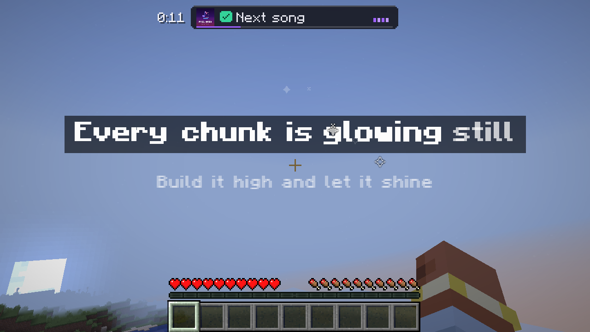 |

### Creator tools: Blockbench plugin and live link

- **Blockbench plugin** ([`blockbench/vibey.js`](blockbench/)) with two formats, *Vibey Cosmetic* and *Vibey
  Emote*: a reference player, attach points per group, animations, particle/sound/visibility keyframes, embedded
  textures and sounds, validation, import and export of `.vibey` files.
- **Live link:** turn on *Creator mode* in the *Blockbench link* module and every change in Blockbench shows up in
  the running game within a second, as a local *DEV* item (never uploaded anywhere).

| Pushed from Blockbench, live in game | Emote in Blockbench |
|---|---|
| 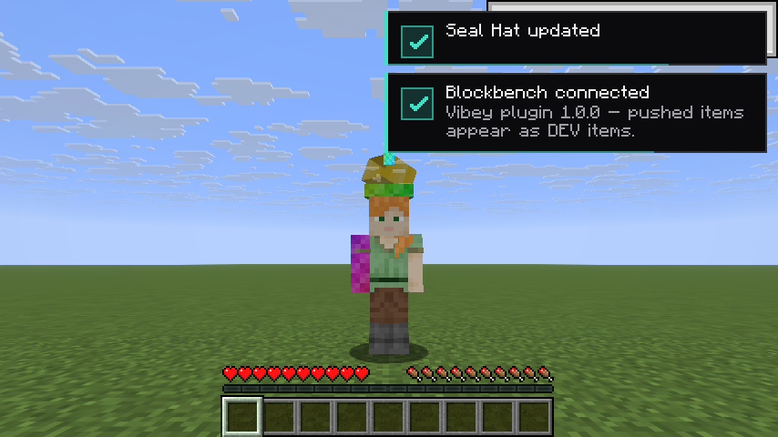 |  |

## Keys

| Key | What | Module |
|---|---|---|
| **Right Shift** | Open the Vibey menu | core |
| **G** | Open the social sidebar (friends, chats, requests, inbox) | Social |
| **B** | Emote wheel (hold, point, release) | Emotes |
| **K** | Open the lyrics menu | Lyrics (Fabric) |
| *unbound* | Open the wardrobe | Cosmetics |
| *unbound* | Open the host screen | Multiplayer |
| *unbound* | Play / pause song, next / previous song, hide / show lyrics, lyrics 0.1 s earlier / later | Lyrics (Fabric) |

Change them under *Options → Controls → Vibey Client* or in the module settings in the Vibey menu. The keys only
work while their module is switched on.

## Installation

1. Install [Fabric Loader](https://fabricmc.net/use/) with [Fabric API](https://modrinth.com/mod/fabric-api), or
   [NeoForge](https://neoforged.net/).
2. Put the Vibey Client jar for your loader and Minecraft version into `.minecraft/mods/`:

   | Minecraft | Fabric jar | NeoForge jar |
   |---|---|---|
   | 1.21, 1.21.1 | `vibey-client-fabric-1.21-1.21.1-<version>.jar` | `vibey-client-neoforge-1.21-1.21.1-<version>.jar` |
   | 1.21.2, 1.21.3 | `vibey-client-fabric-1.21.2-1.21.3-<version>.jar` | `vibey-client-neoforge-1.21.2-1.21.3-<version>.jar` |
   | 1.21.4 | `vibey-client-fabric-1.21.4-<version>.jar` | `vibey-client-neoforge-1.21.4-<version>.jar` |
   | 1.21.5 | `vibey-client-fabric-1.21.5-<version>.jar` | `vibey-client-neoforge-1.21.5-<version>.jar` |
   | 1.21.6 – 1.21.8 | `vibey-client-fabric-1.21.6-1.21.8-<version>.jar` | `vibey-client-neoforge-1.21.6-1.21.8-<version>.jar` |
   | 1.21.9, 1.21.10 | `vibey-client-fabric-1.21.9-1.21.10-<version>.jar` | `vibey-client-neoforge-1.21.9-1.21.10-<version>.jar` |
   | 1.21.11 | `vibey-client-fabric-1.21.11-<version>.jar` | `vibey-client-neoforge-1.21.11-<version>.jar` |
   | 26.1 | `vibey-client-fabric-26.1-<version>.jar` | `vibey-client-neoforge-26.1-<version>.jar` |
   | 26.2 | `vibey-client-fabric-26.2-<version>.jar` | `vibey-client-neoforge-26.2-<version>.jar` |
   | 26.3 | `vibey-client-fabric-26.3-<version>.jar` | `vibey-client-neoforge-26.3-<version>.jar` |

3. Start the game. The welcome screen asks for your language and whether online features should be on.

- **Fabric** needs [Fabric API](https://modrinth.com/mod/fabric-api).
- **NeoForge:** everything except the lyrics module (it is Fabric only, like the standalone *Vibey Lyrics*).
- **On a server (optional):** the same jar can also go on a dedicated server. It then only relays cosmetics,
  emotes and module messages between players who have Vibey Client, so they see each other without the backend.
  Players without the mod can still join. LAN and hosted worlds do this automatically.

### Works alongside the standalone mods

Already using **Vibey Multiplayer** (`vibey`) or **Vibey Lyrics** (`vibeylyrics`)? Keep them. If one of them is
installed, the matching module switches itself off and shows *Provided by the installed standalone mod*, so nothing
runs twice. On first start the module imports the standalone mod's settings (`config/vibey.json`,
`config/vibey-lyrics.json`), and songs are shared with Vibey Lyrics in `.minecraft/vibey-lyrics/`.

## Privacy

- **Online features are optional.** You choose on first start and can change it any time under *Global settings →
  Online features*. When they are off, Vibey Client does not connect to anything: no social module, cosmetics only
  for you and through the server channel.
- **Login with Mojang's own check.** When online features are on, the client logs in to the Vibe backend
  (`vibe.henny.dev`) the same way a Minecraft server checks you: the game tells Mojang's session server "I am
  joining", the backend asks Mojang "has this player joined?" (`hasJoined`). **Your Minecraft access token never
  leaves the game**; it only goes to Mojang, as on every server join.
- **What the backend stores:** your UUID and name, your friends, requests and blocks, your chats, your privacy
  settings, your status and what you play (if *Show what I am playing* is on), your cosmetic loadout and emote wheel,
  and your logged-in devices (client version and OS, so you can log them out). Nothing else.
- **What it sees while you play:** to show other players' cosmetics, the client asks for the loadouts of the players
  around you (by UUID). Emotes you play are sent to the players subscribed to you.
- **On your computer:** settings in `config/vibeyclient/`, the backend login (rotating tokens, not your Minecraft
  token) in `vibeyclient/auth.json`, downloaded cosmetics in `vibeyclient/cache/`, and with *Creator mode* on the
  live link port and token in `vibeyclient/devlink.json` (the live link only accepts connections from this
  computer).
- **Other online parts:** the multiplayer module talks to the Vibey relay only while you host. The lyrics module only
  sends artist, title, album and length to [LRCLIB](https://lrclib.net) to find lyrics, and *Advanced → Online lyrics*
  turns that off.

## Making cosmetics & emotes

Everything in the starter set was made with the same tools you can use:

- [docs/BLOCKBENCH.md](docs/BLOCKBENCH.md): install the Blockbench plugin, model on the reference player, animate,
  add particles and sounds, export and push live into the game.
- [docs/FORMAT.md](docs/FORMAT.md): the `.vibey` file format explained for creators, with examples.
- [docs/CONTENT.md](docs/CONTENT.md): the starter set and the code toolkit that builds it.
- [docs/SPEC.md §5](docs/SPEC.md#5-the-vibey-asset-format-v1): the normative format reference.

Pushed items appear only for you, marked *DEV*. Getting an item into the shared catalog goes through Vibe Craft
Studios.

## Development

All docs: [docs/README.md](docs/README.md). Product contract: [docs/SPEC.md](docs/SPEC.md). Writing modules:
[docs/MODULES.md](docs/MODULES.md).

Requires JDK 21 and JDK 25 (Minecraft 26.x); Gradle picks them via toolchains. Built with
[Stonecutter](https://stonecutter.kikugie.dev/) 0.9.5: one source tree, one Gradle subproject per loader and
Minecraft line (`versions/<loader>-<mc>/gradle.properties`). The sources are written for **fabric-1.21.11**;
never switch the Stonecutter active version (it rewrites `src/`), build other targets by name instead.

```sh
./gradlew buildAll                              # all 20 jars (10 Minecraft lines × Fabric/NeoForge) → build/dist
./gradlew :fabric-1.21.11:build                 # one target (also :neoforge-26.3:build, :fabric-1.21.1:build, ...)
./gradlew :fabric-1.21.11:runClient             # dev client (Fabric)
./gradlew :neoforge-1.21.11:runClient           # dev client (NeoForge)
./gradlew :fabric-1.21.11:runServer             # dedicated server (accept the EULA in versions/fabric-1.21.11/run-server)
./gradlew :fabric-1.21.11:runClientGameTest     # client game test, screenshots in versions/fabric-1.21.11/build/run/clientGameTest/screenshots
./gradlew :neoforge-1.21.11:runClient -Dvibeyclient.smoke=true   # smoke: boot, log "[vibeyclient-smoke]", quit
./gradlew :fabric-1.21.11:runServer -Dvibeyclient.smoke=true     # same for a dedicated server (+ checks no client classes loaded)
./gradlew :fabric-1.21.4:runClient "-Dvibeyclient.tour=$PWD/build/tour/fabric-1.21.4"   # dev tour: every screen + cosmetics/emotes in a flat world, screenshots, PASS/FAIL per step, quit
```

The client game test covers the UI (`VibeyUiGameTest`, see [docs/UI.md](docs/UI.md#testing)) and cosmetics and
emotes (`CosmeticsGameTest`, see [docs/AVATAR.md](docs/AVATAR.md#testing)).

Social against a **local** backend (never the dev bypass against production): start vibe-backend with
`AUTH_DEV_BYPASS=1` (see its `docs/DEPLOY.md`), then

```sh
./gradlew :fabric-1.21.11:runClient -Dvibeyclient.devAuth=true -Dvibeyclient.api=http://localhost:3100 -Dvibeyclient.username=Alex
./gradlew :fabric-1.21.11:runClientGameTest -Dvibeyclient.socialTest=true -Dvibeyclient.devAuth=true     -Dvibeyclient.api=http://localhost:3100 -Dvibeyclient.username=VibeyTester   # bots: scripts/social-bots.ts
```

`vibeyclient.devAuth` only works in a dev workspace (release builds always log in through Mojang). On NeoForge use
`127.0.0.1` instead of `localhost`.

Multi-client tests (dev workspace only): `-Dvibeyclient.devDriver=<port>` starts a small local remote control
(`dev/DevDriver`) so scripts can equip items, play emotes and take screenshots in several clients at once;
`scripts/live-sync-watch.ts` logs what the backend sends a third account; `-Dvibeyclient.devOfflineHost=true` lets
a hosted world accept dev accounts without a Mojang session (for invite tests through a local relay started with
`ALLOW_OFFLINE=1 DOMAIN=127-0-0-1.nip.io`). None of these exist in release builds.

Default backend (`https://vibe.henny.dev`) and relay are set in `gradle.properties` and baked into the generated
`BuildInfo` class. They are our services, for official builds only: forks must set their own (see
[SERVICES.md](https://github.com/vibec-studios/.github/blob/main/SERVICES.md)), and local development uses a local backend/relay.

### Releases

1. Bump `mod_version` (`gradle.properties`), `version` in `blockbench/package.json` and `VERSION` in `blockbench/vibey.js`;
   add a `## <version>` section to `CHANGELOG.md`. New Minecraft patch versions of a line go into
   `gradle/mc-versions.json` (checked by `./gradlew checkMcVersions`).
2. Check locally: `./gradlew buildAll`, then `node tools/release-manifest.mjs --hashes` prints the manifest for
   `build/dist` (`node --test tools/release-manifest.test.mjs` for the script itself).
3. Merge to `main` and publish a GitHub release with tag `v<version>`. A GitHub pre-release or a tag with a `-` suffix
   (`v0.3.0-beta.1`) goes to the beta channel. The release text becomes the changelog (empty = the CHANGELOG.md
   section). `.github/workflows/release.yml` builds all jars and attaches them, `vibey.js` and
   **`vibey-manifest.json`** to the release. CI never contacts the Vibe backend: the backend imports releases from
   GitHub itself and checks every download against the manifest.

   `vibey-manifest.json` is the VIBE-API-2 §2 manifest plus `sha256` and `size` per file:
   `{version, channel, changelog, files: [{loader, mcVersions, file, requires, sha256, size}], blockbench: {version,
   file, sha256, size}}`; `file` is the GitHub asset name. It is uploaded last, so it only appears when all files are
   there. `blockbench/vibey.js` is hashed as committed (LF; `.gitattributes` keeps it LF on Windows too, and the tool
   refuses a CRLF copy).
4. **Fallback** (GitHub import not available): publish from your machine, outside Cloudflare's bot protection for CI:
   `CLIENT_PUBLISH_TOKEN=… node tools/release-manifest.mjs --tag v<version> --publish
   https://vibe.henny.dev/internal/client/v1/releases` (files staged in batches below the 100 MB proxy limit, then
   the release by sha256; exit code 3 = already published). Test against a local backend first
   (`--publish http://127.0.0.1:<port>/internal/client/v1/releases`). Never commit or print the token.

Layout: common, server-safe code in `dev.henny.vibeyclient` (`Vibey`, `Platform`, `Compat`, `net/`), client core in
`client/`, the module API in `api/`, UI in `ui/`, the cosmetics/emotes engine in `avatar/`, modules in
`module/<id>/`, loader entry points in `fabric/` and `neoforge/`. Starter content: `content/`
([docs/CONTENT.md](docs/CONTENT.md)); Blockbench plugin: `blockbench/` ([blockbench/README.md](blockbench/README.md)).

### Multiplayer and lyrics modules

Ports of the standalone mods *Vibey Multiplayer* (`vibey`) and *Vibey Lyrics* (`vibeylyrics`, Fabric only). If one of
them is installed, the matching module switches itself off (no payloads, keybinds, pause buttons or mixins). Settings
live in `config/vibeyclient/multiplayer.json` / `lyrics.json`; on first start the standalone mods' `config/vibey.json`
and `config/vibey-lyrics.json` are imported. Songs are shared with Vibey Lyrics in `.minecraft/vibey-lyrics/`.

```sh
# local relay for hosting tests (never test against the production relay)
cd ../vibey-multiplayer/relay && ALLOW_OFFLINE=1 PORT=26400 DATA_DIR=/tmp/relaydata node src/main.ts
./gradlew :fabric-1.21.11:runClientGameTest                          # hosts through 127.0.0.1:26400 (-Dvibeyclient.test.relay=off skips it)
./gradlew :fabric-1.21.11:runClientGameTest "-Dvibeyclient.test.addMods=<vibey.jar>;<vibeylyrics.jar>"   # conflict test
./gradlew :neoforge-1.21.11:runClient -Dvibeyclient.mpcheck=true -Dvibeyclient.mpcheck.relay=127.0.0.1:26400   # NeoForge screenshots → run/screenshots
```

## Credits

The seal mascot, wordmark, icons, UI, all starter cosmetics and emotes (models, textures, animations, synthesized
sounds) are original work by Vibe Craft Studios. The multiplayer and lyrics modules come from our MIT-licensed
[Vibey Multiplayer](https://github.com/vibec-studios/vibey-multiplayer) and
[Vibey Lyrics](https://github.com/vibec-studios/vibey-lyrics) (notices in [`licenses/`](licenses/)).

Bundled third-party parts (details in [NOTICE](NOTICE)):

- **Fonts** of the lyrics module (Fabric jars only): Bebas Neue, Bungee, Caveat, Fredoka, Kanit, Kaushan Script,
  Monoton, Montserrat, Pacifico, Poppins, Press Start 2P and Unbounded under the SIL Open Font License 1.1, Permanent
  Marker under the Apache License 2.0. License texts: [`licenses/lyrics/fonts/`](licenses/lyrics/fonts/), and inside
  every Fabric jar under `licenses/vibeyclient/lyrics/`.
- **[JavaMP3](https://github.com/delthas/JavaMP3)** (MIT), the MP3 decoder of the lyrics module, shipped inside the
  Fabric jars.
- Lyrics found online come from [LRCLIB](https://lrclib.net); the mod itself ships no song lyrics apart from its own
  demo song.

Not an official Minecraft product. Not approved by or associated with Mojang or Microsoft.

## Lizenz / License

**Code:** [Apache License 2.0](LICENSE). Forken, ändern und weitergeben ist erlaubt.

**Nicht** von der Code-Lizenz erfasst (gilt für alle Repos von Vibe Craft Studios,
[LICENSING.md](https://github.com/vibec-studios/.github/blob/main/LICENSING.md)):

- **Namen und Logos** („Vibe“, „Vibey“, „Vibey Client“, „Vibe Craft Studios“, die Robbe): Forks brauchen einen
  eigenen Namen, eine eigene Mod-ID und eigene Logos –
  [TRADEMARKS.md](https://github.com/vibec-studios/.github/blob/main/TRADEMARKS.md).
- **Grafiken und Modelle** (Logo, Icons, Robbe, Starter-Cosmetics und -Emotes, Texturen, Sounds, Screenshots, der
  Referenzspieler des Blockbench-Plugins): alle Rechte vorbehalten –
  [ASSETS-POLICY.md](https://github.com/vibec-studios/.github/blob/main/ASSETS-POLICY.md); Pfade in [NOTICE](NOTICE).
- **Vibe-Dienste** (Backend `vibe.henny.dev` mit Cosmetics-Katalog, Loadouts und Downloads, Relay
  `vibey.henny.dev`): nur für offizielle Builds –
  [SERVICES.md](https://github.com/vibec-studios/.github/blob/main/SERVICES.md).

Code aus *Vibey Multiplayer* und *Vibey Lyrics*, der dort vor dem 18.11.2026 unter MIT veröffentlicht wurde, bleibt
unter MIT ([`licenses/`](licenses/), Details in [NOTICE](NOTICE)).

*English:* the code is Apache-2.0. Our names and logos, the seal, artwork and models, and the Vibe online services are
not included: forks must use their own name, artwork and backend. See the linked policies and [NOTICE](NOTICE) for
the asset paths in this repository. Code from Vibey Multiplayer and Vibey Lyrics that was published under MIT before
2026-11-18 stays available under MIT (`licenses/`).
