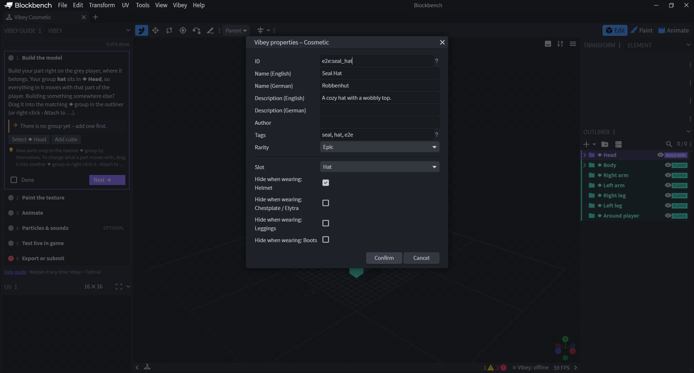
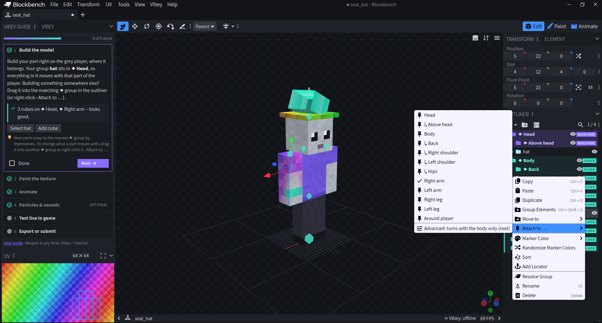
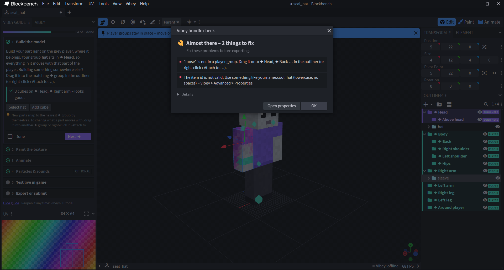

# Making cosmetics and emotes in Blockbench

The Vibey Blockbench plugin (`blockbench/vibey.js`, version 0.2.5) turns Blockbench into the editor for Vibey Client
cosmetics and emotes. It writes `.vibey` bundles (see [SPEC §5](SPEC.md#5-the-vibey-asset-format-v1)) and can push
them straight into the running game over the live link ([SPEC §8](SPEC.md#8-blockbench-live-link-devlink)).

> See also: [FORMAT.md](FORMAT.md) (what the plugin writes, explained) · [CONTENT.md](CONTENT.md) (the starter set
> to learn from) · [blockbench/README.md](../blockbench/README.md) (plugin development) · [docs index](README.md)


## Install

The **Vibe Launcher** installs and updates the plugin for you. By hand:

1. Install the Blockbench desktop app (5.0 or newer) and Vibey Client **0.2.0 or newer** (for the live link and
   *Submit to Vibe*).
2. Download `vibey.js` from the newest **Vibey Blockbench Plugin** release on GitHub
   ([releases](https://github.com/vibec-studios/vibey-client/releases), tags `blockbench-v<version>` – the plugin is
   released on its own, not with the client).
3. **File > Plugins…** → click the *Load Plugin from File* icon in the top right of the dialog → choose the
   downloaded `vibey.js` → confirm.
4. A **Vibey** menu appears in the menu bar. The first time, the **New Vibey item** wizard opens by itself.

Keep the file name `vibey.js` – Blockbench uses it as the plugin id. To update, load the new file again.
Developers can load `blockbench/vibey.js` straight from a checkout.

### Which Vibey Client?

| Plugin feature | Vibey Client |
|---|---|
| Live link, push / play, auto-push, *Submit to Vibe*, *My submissions* | 0.2.0 or newer |
| Wardrobe thumbnails of pushed items, optional animations `sprint` / `glide` / `idle_long` / `happy`, `cosmetic.offsetWhen` | 0.3.0 or newer |

An older client simply ignores the 0.3.0 parts – the item still loads and plays (missing states fall back to
`idle` / `walk` / `fly`). The plugin reads the client version when it connects and, after a push, says once what the
game ignores, e.g. *"Wardrobe thumbnails and offsetWhen need Vibey Client 0.3.0 – your game has 0.2.1."* (also in the
*Vibey* tab under the live link). Exports always contain everything and validate the same way.

## Getting started

1. **Vibey > New item…** (German UI: *Vibey > Neues Item…*) opens a short wizard with four steps:
   - **Type** – *Cosmetic* (something your character wears) or *Emote* (a move it plays).
   - **Slot** – cape, wings, aura, pet, shield, hat or back (cosmetics; each card says which player group it builds
     on, e.g. *on ◆ Back* for wings) · **Options** – plays once or loops, length (emotes).
   - **Name** – English name, German name optional. The id is made from the name (`creator:frost_wings`; your own
     namespace once you set one) and can be changed under *Advanced*, together with author and rarity. The reserved
     `vibey:` namespace is refused. When Vibe approves a submission the catalog id becomes `community:<name>`.
   - **Start** – *Start empty*, or a copy of an item from the starter set (embedded in the plugin, works offline).
2. The wizard prepares everything for the slot:

   | Slot | What you get |
   |---|---|
   | Hat | group `hat` in **◆ Head**, animations `idle`, `walk`, hidden under a helmet, 64×64 texture |
   | Back | group `back` in **◆ Back**, `idle`, `walk`, `sneak`, 64×64 texture |
   | Wings | group `wings` in **◆ Back** at the shoulder blades with `wing_right` / `wing_left` (their pivots are the joints), `idle`, `walk`, `fly`, `sneak`, `glide`, 64×64 texture |
   | Aura | group `aura` in **◆ Around player** (follows the player's position) with locator `aura_center`, `idle`, 64×64 texture |
   | Pet | group `pet` in **◆ Beside player** – where the game draws the pet next to you –, pet follow `ground`, `idle`, `walk`, `fly`, `idle_long`, `happy`, 64×64 texture |
   | Cape | texture only: a 64×32 texture in the vanilla cape layout with a colour guide (purple = the side others see, dark = inside, teal = edges, grey = elytra) and a locked **preview** cape on the reference player that is never exported |
   | Shield | texture only: a 64×64 texture in the vanilla shield layout (purple = front, dark = back, teal = edges, grey = handle) and a locked, never exported **preview** shield |
   | Emote | the player groups (◆ Whole player > ◆ Head, ◆ Body, arms, legs) and an empty animation `main` (loop and length from the wizard) |

   All animations are created empty, the reference player is shown with its player groups (the slot's groups are
   highlighted), your own group is selected so the first cube lands in it, and the camera looks at the right side
   (wings, capes and back items from behind).
3. The **Vibey guide** (left sidebar, next to the *Vibey* tab) walks through the rest. *File > New > Vibey Cosmetic /
   Vibey Emote* opens the same wizard.

### The Vibey guide

Six steps, each with a short text, a tip, buttons that do the next thing (select the group, add a cube, Paint mode,
Animate mode …) and an **automatic check**:

| Step | Check examples |
|---|---|
| 1 Build the model (props for emotes, nothing for capes/shields) | "No cubes in "wings" yet." · "12 cubes on ◆ Back – looks good." · ""stray" is not attached to the player yet – drag it into a ◆ group." |
| 2 Paint the texture | "The texture is still the template – paint over it." · "Your item has no texture yet." |
| 3 Animate | "No keyframes in "idle" yet." · "4 keyframes in idle." |
| 4 Particles & sounds (optional) | "No particles or sounds – that is fine." |
| 5 Test live in game | "Not connected to the game." · "Sent to the game – check your character!" |
| 6 Export or submit | "2 things to fix before exporting." · "Exported – well done!" |

Steps can be ticked off (*Done*) and *Next* moves on; the progress bar counts finished steps (a passing check counts
too). The guide never runs off the bottom of the window: it scrolls inside its panel and keeps the open step in view
(also on small screens and with 125 / 150 % display scaling). The guide is saved with the project (`.bbmodel`). *Hide guide* closes it; **Vibey > Tutorial** (*Anleitung*)
opens it again – the choice is remembered in Blockbench's local storage, like the first-start wizard.

### Test live in game

**Vibey > Test live in game** (*Live im Spiel testen*, also the big button in guide step 5) connects automatically and
sends the open item: cosmetics are equipped, emotes are played. A render of the viewport goes along as the item's
wardrobe thumbnail (256×256, smaller if the PNG would exceed 256 KiB), so the DEV item shows a picture instead of the
letter tile (Vibey Client 0.3.0 or newer; older clients ignore it); auto-pushes keep the last thumbnail. If the game cannot be reached the plugin explains what
to do and keeps looking in the background – the item is sent as soon as the game is there:

1. Start Minecraft with Vibey Client.
2. Open the Vibey menu (Right Shift, or the Vibey button on the title / pause screen).
3. **Modules → Blockbench link** and turn on **Creator mode** (German: *Module → Blockbench-Link → Creator-Modus*).
   From Vibey Client 0.3.0 the Blockbench link sits under **For creators** (*Für Creator*) at the bottom of Modules.
4. Click *Test live in game* again.

Playing from a launcher instance? Pick its game folder once in *Vibey > Advanced > Live link settings…*.

### The Vibey menu

| Entry (English / German) | What it does |
|---|---|
| New item… / Neues Item… | the wizard |
| Tutorial / Anleitung | shows the Vibey guide |
| Test live in game / Live im Spiel testen | connect + push (see above) |
| Export / Submit… / Exportieren / Einreichen… | save a `.vibey` file, *Submit to Vibe*, *My submissions* |
| Advanced ▸ / Erweitert ▸ | Vibey properties, validation details, reference player, repair player groups, import `.vibey`, connect/disconnect, push, play emote, auto-push, live link settings, add sound, add particle sprite, submit to Vibe, my submissions, about |

Menu texts follow Blockbench's language setting (English or German).

### When something goes wrong

Problems are explained in plain words with numbered steps to fix them, for example *"Can't reach the game – Start
Minecraft with Vibey Client. In the game open Vibey menu (Right Shift) → Modules → Blockbench link (from Vibey Client
0.3.0 under "For creators") and turn on Creator mode."*
The technical message stays available under **Details**. This covers validation ("Almost there – 2 things to fix",
with a button to the properties when the id or name is the problem), the live link (game not found, wrong token,
connection lost, no answer), the game rejecting an item, export, import and *Submit to Vibe* (e.g. "The game isn't
signed in to Vibe"). Blockbench's own validator list in the status bar uses the same plain texts.

## Vibey Cosmetic

The wizard sets everything up; **Vibey > Advanced > Vibey Properties…** (or the button in the *Vibey* tab) changes it
later:



| Field | Meaning |
|---|---|
| ID | `namespace:path`, only `a-z 0-9 _ . -`. `vibey:` is reserved for official items – use your own namespace. |
| Name (English/German) | English is required. |
| Description, Author, Tags | Optional. Tags are comma separated. |
| Rarity | common / rare / epic / legendary (no prices anywhere). |
| Slot | cape, wings, aura, pet, shield, hat, back. |
| Hide when wearing | Hide the cosmetic when that armor piece is worn. |
| Pet follow point / scale | Only for pets. |
| Cape / shield texture | Capes and shields can be just a texture in the vanilla 64×32 cape / 64×64 shield layout; the model is then optional. |

### Build on the player

The grey mannequin is a reference of the vanilla player (wide arms, 64×64 skin layout); the teal wrist band marks
the **right** arm. Toggle it with the checkbox in the *Vibey* tab or *Vibey > Advanced > Show reference player*.
It comes with **ready-made player groups**, like the real player – teal in the outliner, labelled with ◆ and the
word *player*; the groups your slot builds on are purple (*build here*):



**Build your part on the player, where it belongs, and keep it in the matching group.** Everything inside a group
moves with that part of the player in game (walking, sneaking, looking around, emotes):

| Player group (German) | Moves with (`attach` in the `.vibey`) | Pivot (Blockbench) | Typical parts |
|---|---|---|---|
| ◆ Head (Kopf) | `head` | `[0, 24, 0]` | hats, glasses, masks |
| └ ◆ Above head (Über dem Kopf) | `head` | `[0, 32, 0]` | halos, things floating above the head |
| ◆ Body (Körper) | `body` | `[0, 24, 0]` | scarves, chest items |
| └ ◆ Back (Rücken) | `body` | `[0, 24, 2]` | wings, backpacks, quivers, capes made of cubes |
| └ ◆ Right shoulder / ◆ Left shoulder (Rechte / Linke Schulter) | `body` | `[±6, 24, 0]` | pauldrons, a parrot-like buddy |
| └ ◆ Hips (Hüfte) | `body` | `[0, 12, 0]` | belts, tails |
| ◆ Right arm / ◆ Left arm (Rechter / Linker Arm) | `right_arm` / `left_arm` | `[5, 22, 0]` / `[-5, 22, 0]` | cuffs, gloves, held props |
| ◆ Right leg / ◆ Left leg (Rechtes / Linkes Bein) | `right_leg` / `left_leg` | `[1.9, 12, 0]` / `[-1.9, 12, 0]` | shoes, leg bands |
| ◆ Around player (Um den Spieler) – not for pets | `world` | `[0, 0, 0]` | auras, rings around the feet |
| ◆ Beside player (Neben dem Spieler) – pets only | `world` (relative to the pet's follow point) | follow point | the pet |

Emotes have the same groups inside **◆ Whole player** (`root`, the player bone that moves the whole body).

How a part gets into a group – all three can be undone with Ctrl+Z:

1. **Drag** it onto the group in the outliner.
2. **Right-click › Attach to …** (German *An … anheften*) › the group. Under *Advanced: turns with the body only
   (root)* a cosmetic part can follow only the body rotation (`attach: root`), outside the player groups.
3. **Just build**: a part you add outside the groups snaps to the most plausible group by itself, with a short note
   at the bottom (*"Attached to ◆ Back – change it with right-click › Attach to …"*). The rules are simple: pets go
   to ◆ Beside player, auras to ◆ Around player; a part wider than the player in X and Z surrounds it (◆ Around
   player); otherwise the group whose zone holds the centre of the part's cubes, else the nearest one, else your
   slot's group. ◆ Above head only takes parts that float above the head – a hat sitting on the head goes to
   ◆ Head. A part attached this way follows when you move it to another body part; Ctrl+Z right after the note keeps
   it where it was, and parts you placed by hand (drag, right-click) are never moved for you.

More details:

- Space: pixels, origin at the feet, +Y up, the player faces **north (-Z)**. As in Blockbench's own player model,
  the right arm is at **+X** (pivot `[5, 22, 0]`), the left arm at -X. Coordinates stay **absolute** – what you see
  on the reference player is what the game renders.
- Each group of yours directly in a player group becomes a root bone with that group's `attach`; its sub-groups
  stay its children. Cubes placed straight into a player group are exported as a bone `<group>_cubes` (e.g.
  `back_cubes`), pivot = the player group's pivot.
- **Pets** are built beside the player, where the game draws them (◆ Beside player sits on the pet's follow point:
  1 block to the right and a bit behind for `ground`, by the shoulder for `float`, on the shoulder for
  `shoulder_left` / `shoulder_right`). The plugin exports the pet relative to that point, exactly as the game expects.
  Changing the follow point in the properties moves the group and the pet with it.
- The player groups stay in place: if one is moved or rotated by accident it snaps back (with a note); *Vibey >
  Advanced > Repair player groups* restores missing ones. Their mannequin cubes are only a reference and are never
  exported; keyframes on a player group of a cosmetic only preview in Blockbench.
- **Glowing (emissive)** and **Translucent** per group: select your group and open the **Element** tab next to
  *Transform*.
- **Old projects** (0.2.4 and older, where each root group had an *Attach to* setting) and imported `.vibey` files
  open in the new structure by themselves – every part lands in the group of its `attach`, pets on the pet anchor –
  and export exactly the same bytes as before.
- Box UV is the default (per-cube toggle for per-face UV). Faces you disable are not drawn.
- Multiple textures are allowed. The starred texture (*use as default*) is the model default; faces can use others.
  Animated textures: a vertical strip with frames, set *frame time* / order in the texture properties.
- **Locators** mark points for particles/sounds (add via the outliner "+" menu).

### Animations

Use Animate mode as usual. Names with meaning for cosmetics: `idle` (always), `walk` (blended by walk speed),
`fly` (elytra/creative flying), `sneak`, and the optional states of client 0.3.0: `sprint`, `glide` (elytra),
`idle_long` (standing still ~10 s) and `happy` (while the owner plays an emote) – see FORMAT.md. The wizard prepares
`idle_long` and `happy` for pets and `glide` for wings; leave them empty if you do not need them (an empty animation
counts as missing, the item then plays `idle` / `fly` there). Supported: rotation, position and scale keyframes with **linear**,
**catmullrom** and **step** interpolation, and split (pre/post) keyframes. Molang expressions are not supported –
use numbers.

## Vibey Emote

The wizard (type *Emote*) asks for the name, *plays once / loops*, the length and *stop when the player moves*.
*Vibey > Advanced > Vibey Properties…* has all emote options (id, names, tags, rarity, animation, loop, switch to third
person, stop when moving, hide held items).


- The project starts with the same player groups as cosmetics: **◆ Whole player** (`root`) holding ◆ Head (with
  ◆ Above head), ◆ Body (with ◆ Back, shoulders, ◆ Hips), the arms and legs, plus ◆ Around player – vanilla pivots –
  and an animation `main`. ◆ Whole player, ◆ Head, ◆ Body and the arms and legs are real bones: select them and
  keyframe them in Animate mode (they are exported under their vanilla names `root`, `head`, `body`, `right_arm` …).
  Their grey cubes are only a reference and follow the animation.
- ◆ Whole player moves/rotates the whole player; keyframe values are offsets relative to the standing pose.
- **Props** work like cosmetic parts: build them on the player and put them into the group they belong to (a flag in
  ◆ Right arm) – drag, right-click › Attach to … or let them snap. Groups directly in ◆ Whole player follow the whole
  player. Cubes placed directly in a player group are exported as an extra bone `<part>_cubes` automatically.
- Do not move or rotate the player groups in Edit mode – they snap back; *Vibey > Advanced > Repair player groups*
  restores missing ones. Old emote projects (player bones named `root`, `head` …) are converted when opened.

## Effects: particles, sounds, visibility

In Animate mode open the **Effects** track in the timeline and add keyframes to its rows. Select a keyframe to edit
it in the **Keyframe** panel:

| Row | Vibey fields | Exported as |
|---|---|---|
| Particle | *Effect* = particle id (`minecraft:heart`, `heart` works too) **or** *Sprite* = id of a Vibey sprite; *Locator*; *Count*; *Spread (x y z)*; *Velocity (x y z)*; *Lifetime (s)*; *Size*; *Gravity*; *Glowing* | `particle` events |
| Sound | *Effect* = sound event id (`minecraft:entity.player.levelup`) or the id of an embedded sound; *Volume*; *Pitch*; optional *Locator* | `sound` events |
| Instructions (timeline) | *Visibility: bone*, *Visible* | `visibility` events (bone hidden/shown from that time on) |

One keyframe may hold several particles/sounds (the "+" in the Keyframe panel). Vectors accept `0.2` (all axes) or
`0.2 0.1 0.2`. Visibility events are previewed in Blockbench while scrubbing.

**Embedded sounds**: *Vibey* tab > Sounds > "+" (OGG Vorbis, max 512 KiB each). ▶ previews, ✎ renames.
**Sprites** (for sprite particles): *Vibey* tab > Sprites > "+" → id, texture and UV rectangle `u1 v1 u2 v2`.

## Export, import and validation

- **Vibey > Export / Submit… > Save as .vibey file** (or **File > Export > Vibey Bundle (.vibey)**) writes one
  self-contained JSON file (textures and sounds embedded as base64). Export is blocked while there are errors – the
  dialog says in plain words what to fix; warnings are shown afterwards.
- **File > Import > Vibey Bundle (.vibey)**, *Vibey > Advanced > Import .vibey file…* (or drag & drop / File > Open)
  turns a bundle back into an editable
  project. Everything the format stores round-trips; exporting an imported file gives the same bytes (including
  fields without an editor in the plugin such as `cosmetic.offsetWhen`, which the validator checks as well).
- **Vibey > Advanced > Validation details…** lists problems in plain words, with the technical text under *Details*
  (same rules as SPEC §5: id, names, slot,
  references to textures/bones/locators/sprites/sounds, PNG ≤ 512×512 (strips ≤ 512×4096), ≤ 256 bones, ≤ 2048 cubes,
  OGG ≤ 512 KiB, ≤ 2 MiB total). The problems also appear in Blockbench's status bar validator.



Save your working file as a normal `.bbmodel` (Ctrl+S) – all Vibey settings are kept there too.

## Live link

1. In Minecraft: Vibey menu (Right Shift) → **Modules** → **Blockbench link** (from Vibey Client 0.3.0 under **For creators** at the bottom of Modules) → turn on **Creator mode**. The game
   writes `<game dir>/vibeyclient/devlink.json` with port and token.
2. In Blockbench: **Vibey > Test live in game** connects and sends the item (or *Connect* in the *Vibey* tab, or click
   *Vibey: offline* in the status bar).


*Vibey > Advanced > Live link settings…*:

- **Find game automatically** (default): reads port + token from `devlink.json` in the **game directory**
  (default `%APPDATA%\.minecraft`; pick another folder once – e.g. a launcher instance – it is remembered).
- Otherwise enter **port** (default 47821) and **token** (copy it from the game: Modules → Blockbench link, from
  0.3.0 under For creators).
- **Auto-push on change**: every edit is pushed ~300 ms after you stop (cosmetics are equipped, emotes replayed
  unless *Replay emote on auto-push* is off). Invalid states are skipped and reported in the panel.
- **Connect on startup**.

Buttons: **Push** (cosmetic → equip, emote → play), **Play** (emotes), **Disconnect**. The game loads pushed bundles as
local *DEV* items (never uploaded), replacing the previous version with the same id.

The status bar shows *Vibey: connected / connecting… / not connected*; hover for details. If the game is closed or
restarted the plugin reconnects automatically (0.5 s, 1 s, 2 s … up to 15 s). Common problems (the plugin shows them
in plain words with these fixes; the raw message is under *Details*):

| Dialog | Fix |
|---|---|
| Can't find the game (no …devlink.json) | Start Minecraft with Vibey Client and Creator mode on, or set the right game directory. |
| Can't reach the game (127.0.0.1:… not reachable) | The game is not running / Creator mode is off / different port. |
| The game didn't let Blockbench in (token) | The token was regenerated – enable *Find game automatically* or paste the new token. |
| The game couldn't load your item | The game's validator found a problem; *Details* says which. |

## Submit to Vibe

*Vibey → Export / Submit… → Submit to Vibe* sends the open item to the Vibe team for review (VIBE-API-2 §3). The plugin has no login of
its own: it goes through the running game over the live link, and the game uploads it with its Vibe login (online
features on, signed in). The dialog asks for name and description and can attach a 256×256 thumbnail taken from the
viewport. *My submissions* (in the same dialog and under *Advanced*) lists your submissions with their status (pending, approved, rejected with the
reason, withdrawn) and lets you withdraw open ones; when the team decides, the plugin shows a short notice. If the
game is not signed in to Vibe the plugin says so and how to fix it (Vibey menu → Global settings – from Vibey Client
0.3.0 the *General* tab – → Online features).
Approved items join the catalog as `community:<path>` with your name and reach every player over the air.

## Format notes

- Coordinates are stored exactly as Blockbench shows them (pixels, +Y up, facing -Z, right arm at +X). The client
  converts to Minecraft model space with `x' = -x`, `y' = 24 - y`, `z' = z` (rotations `(-x, -y, z)`), like
  Blockbench's Modded Entity exporter – so what you see on the reference player is what the game renders.
- Keyframe values are Blockbench's values (degrees / pixels / scale factors); split keyframes store `pre`.
- Texture `width`/`height` are the UV size of one frame; the PNG may be higher resolution and/or a vertical strip.
- Cube names and `generated` bones are editor hints; the game ignores unknown fields.

All details: [SPEC §5](SPEC.md#5-the-vibey-asset-format-v1).

## Releases

The plugin is released on its own, independent of the client: one GitHub release per plugin version, tag
**`blockbench-v<version>`**, title *Vibey Blockbench Plugin &lt;version&gt;*, never marked *Latest* (that stays the
client release), not a pre-release. Assets, exactly:

- `vibey.js` – the plugin, byte for byte the committed file (LF).
- `vibey-blockbench.json` – what the Vibe Launcher reads:

  ```json
  { "version": "0.2.4", "file": "vibey.js", "sha256": "<hex of vibey.js>", "size": 380619,
    "min_client": "0.2.0", "notes": "<short German text>" }
  ```

  `sha256`/`size` describe the uploaded `vibey.js`. `min_client` is the oldest Vibey Client with which live link,
  push and *Submit to Vibe* work (`"vibey": { "minClient" }` in `blockbench/package.json`; 0.2.0 added *Submit to
  Vibe*). Features of newer clients degrade gracefully (see *Which Vibey Client?*). `notes` is the `Kurz:` line of
  the version's section in [`blockbench/CHANGELOG.md`](../blockbench/CHANGELOG.md).

The Vibe backend's client import ignores these releases (they have no `vibey-manifest.json`), and client releases no
longer carry `vibey.js` (their manifest says `"blockbench": null`).

**Release a new plugin version:**

1. Bump the version in `blockbench/package.json`, `blockbench/package-lock.json` (`npm install` does it) and
   `VERSION` + the header comment in `blockbench/vibey.js` (`npm test` checks they agree).
2. Add a `## <version>` section to `blockbench/CHANGELOG.md`: first a `Kurz: …` line (one short German sentence for
   the launcher), then the English release text. Raise `vibey.minClient` in `package.json` only if the plugin now
   needs a newer client for live link / push / submit.
3. Check locally: `cd blockbench && npm test && npm run test:blockbench` (also `--lang de`, and once with
   `--game-dir` against a real client), then `node tools/release-json.mjs --tag blockbench-v<version>` prints the
   json for the current `vibey.js`.
4. Merge to `main`, then `git tag blockbench-v<version> && git push origin blockbench-v<version>`.
   [`.github/workflows/blockbench-release.yml`](../.github/workflows/blockbench-release.yml) runs the unit tests,
   checks tag = `package.json` = `VERSION`, takes `vibey.js` from the git blob, builds `vibey-blockbench.json`,
   creates the release (`--latest=false`) and downloads the assets again to verify hash and size. Re-running it
   (or *Run workflow* with the tag) replaces the assets and resets title, notes and the not-latest flag.
