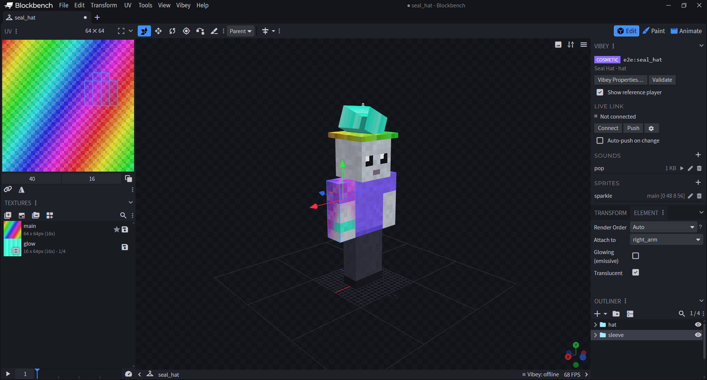
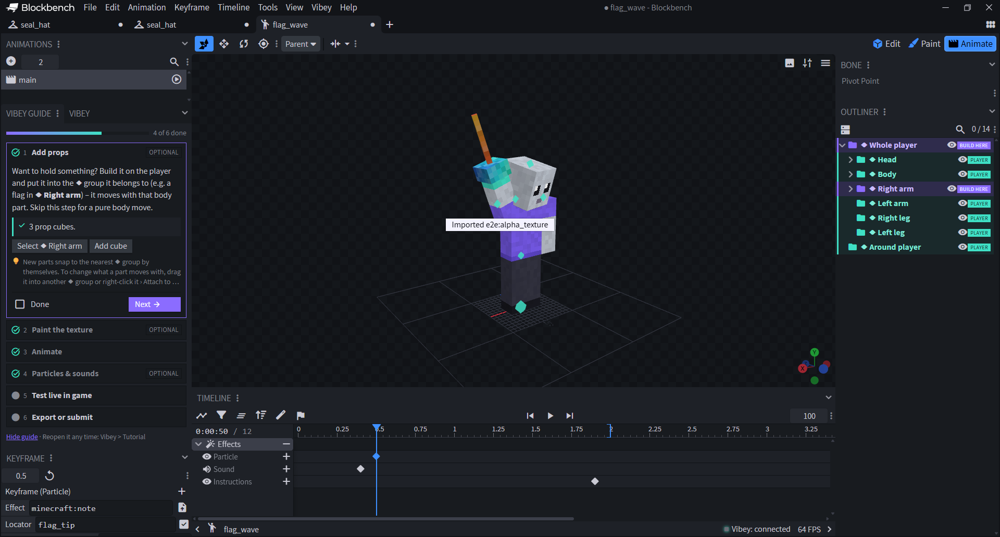
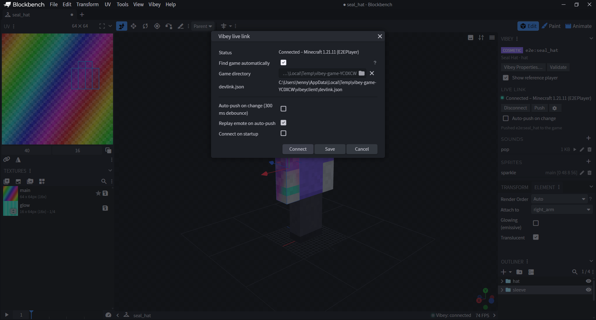

# Making cosmetics and emotes in Blockbench

The Vibey Blockbench plugin (`blockbench/vibey.js`) turns Blockbench into the editor for Vibey Client cosmetics and
emotes. It writes `.vibey` bundles (see [SPEC §5](SPEC.md#5-the-vibey-asset-format-v1)) and can push them straight
into the running game over the live link ([SPEC §8](SPEC.md#8-blockbench-live-link-devlink)).

> See also: [FORMAT.md](FORMAT.md) (what the plugin writes, explained) · [CONTENT.md](CONTENT.md) (the starter set
> to learn from) · [blockbench/README.md](../blockbench/README.md) (plugin development) · [docs index](README.md)

## Install

1. Install the Blockbench desktop app (5.0 or newer).
2. **File > Plugins…** → click the *Load Plugin from File* icon in the top right of the dialog → choose
   `blockbench/vibey.js` from this repository → confirm.
3. A **Vibey** menu appears in the menu bar, and **File > New** lists *Vibey Cosmetic* and *Vibey Emote*.

Keep the file name `vibey.js` – Blockbench uses it as the plugin id. To update, load the new file again.

## Vibey Cosmetic

**File > New > Vibey Cosmetic** opens the properties dialog (you can reopen it any time with
*Vibey > Vibey Properties…* or the button in the Vibey panel):

| Field | Meaning |
|---|---|
| ID | `namespace:path`, only `a-z 0-9 _ . -`. `vibey:` is reserved for official items – use your own namespace. |
| Name (English/German) | English is required. |
| Description, Author, Tags | Optional. Tags are comma separated. |
| Rarity | common / rare / epic / legendary (no prices anywhere). |
| Slot | cape, wings, aura, pet, shield, hat, back. |
| Hide when wearing | Hide the cosmetic when that armor piece is worn. |
| Pet follow point / scale | Only for pets. |
| Cape / shield texture | Capes and shields can be just a texture in the vanilla 64×32 cape / 64×64 shield layout; the model is then optional. |

### Modelling on the reference player

The grey mannequin is a reference of the vanilla player (wide arms, 64×64 skin layout). It is never exported.
Toggle it with the checkbox in the Vibey panel or *Vibey > Show reference player*. The teal wrist band marks the
**right** arm.

- Space: pixels, origin at the feet, +Y up, the player faces **north (-Z)**. As in Blockbench's own player model,
  the right arm is at **+X** (pivot `[5, 22, 0]`), the left arm at -X.
- Every cube and locator must be inside a group. **Root groups** decide what the cosmetic follows. Select a root
  group and open the **Element** tab next to *Transform*:
  - **Attach to**: `head`, `body`, `right_arm`, `left_arm`, `right_leg`, `left_leg`, `root` (body yaw only),
    `world` (feet position + body yaw, smoothed – pets, auras) or *Auto* (slot default: hat → head, cape/wings/back
    → body, shield → left_arm, pet/aura → world).
  - **Glowing (emissive)** and **Translucent** per group.
- Place things exactly where they should be on the reference player – the game renders them in the same spot,
  moving with the part they are attached to.
- Box UV is the default (per-cube toggle for per-face UV). Faces you disable are not drawn.
- Multiple textures are allowed. The starred texture (*use as default*) is the model default; faces can use others.
  Animated textures: a vertical strip with frames, set *frame time* / order in the texture properties.
- **Locators** mark points for particles/sounds (add via the outliner "+" menu).

### Animations

Use Animate mode as usual. Names with meaning for cosmetics: `idle` (always), `walk` (blended by walk speed),
`fly` (elytra/creative flying), `sneak`. Supported: rotation, position and scale keyframes with **linear**,
**catmullrom** and **step** interpolation, and split (pre/post) keyframes. Molang expressions are not supported –
use numbers.

## Vibey Emote

**File > New > Vibey Emote** asks for id, names, tags, rarity and the emote options (animation, loop, switch to third
person, stop when moving, hide held items).

- The project starts with the player rig `root > head, body, right_arm, left_arm, right_leg, left_leg` (vanilla
  pivots) and an animation `main`. These groups are real bones: select them and keyframe them in Animate mode. Their
  grey cubes are only a reference and follow the animation.
- `root` moves/rotates the whole player; keyframe values are offsets relative to the standing pose.
- **Props**: groups inside a player bone move with that part (a flag in `right_arm`). Groups directly under `root`
  follow the whole player. Cubes placed directly in a player bone are exported as an extra bone `<part>_cubes`
  automatically.
- Do not move or rotate the player bones in Edit mode – *Vibey > Repair player rig* restores them.

## Effects: particles, sounds, visibility

In Animate mode open the **Effects** track in the timeline and add keyframes to its rows. Select a keyframe to edit
it in the **Keyframe** panel:

| Row | Vibey fields | Exported as |
|---|---|---|
| Particle | *Effect* = particle id (`minecraft:heart`, `heart` works too) **or** *Sprite* = id of a Vibey sprite; *Locator*; *Count*; *Spread (x y z)*; *Velocity (x y z)*; *Lifetime (s)*; *Size*; *Gravity*; *Glowing* | `particle` events |
| Sound | *Effect* = sound event id (`minecraft:entity.player.levelup`) or the id of an embedded sound; *Volume*; *Pitch*; optional *Locator* | `sound` events |
| Instructions (timeline) | *Visibility: bone*, *Visible* | `visibility` events (bone hidden/shown from that time on) |

One keyframe may hold several particles/sounds (the "+" in the Keyframe panel). Vectors accept `0.2` (all axes) or
`0.2 0.1 0.2`. Visibility events are previewed in Blockbench while scrubbing.

**Embedded sounds**: Vibey panel > Sounds > "+" (OGG Vorbis, max 512 KiB each). ▶ previews, ✎ renames.
**Sprites** (for sprite particles): Vibey panel > Sprites > "+" → id, texture and UV rectangle `u1 v1 u2 v2`.

## Export, import and validation

- **File > Export > Vibey Bundle (.vibey)** writes one self-contained JSON file (textures and sounds embedded as
  base64). Export is blocked while there are errors; warnings are shown afterwards.
- **File > Import > Vibey Bundle (.vibey)** (or drag & drop / File > Open) turns a bundle back into an editable
  project. Everything the format stores round-trips; exporting an imported file gives the same bytes.
- **Vibey > Validate bundle** lists problems with readable messages (same rules as SPEC §5: id, names, slot,
  references to textures/bones/locators/sprites/sounds, PNG ≤ 512×512 (strips ≤ 512×4096), ≤ 256 bones, ≤ 2048 cubes,
  OGG ≤ 512 KiB, ≤ 2 MiB total). The problems also appear in Blockbench's status bar validator.

Save your working file as a normal `.bbmodel` (Ctrl+S) – all Vibey settings are kept there too.

## Live link

1. In Minecraft: Vibey Client settings → **Devlink** → turn on **Creator mode**. The game writes
   `<game dir>/vibeyclient/devlink.json` with port and token.
2. In Blockbench: Vibey panel → **Connect** (or click *Vibey: offline* in the status bar).

*Vibey > Live link settings…*:

- **Find game automatically** (default): reads port + token from `devlink.json` in the **game directory**
  (default `%APPDATA%\.minecraft`; pick another folder once – e.g. a launcher instance – it is remembered).
- Otherwise enter **port** (default 47821) and **token** (copy it from the game settings).
- **Auto-push on change**: every edit is pushed ~300 ms after you stop (cosmetics are equipped, emotes replayed
  unless *Replay emote on auto-push* is off). Invalid states are skipped and reported in the panel.
- **Connect on startup**.

Buttons: **Push** (cosmetic → equip, emote → play), **Play** (emotes), **Disconnect**. The game loads pushed bundles as
local *DEV* items (never uploaded), replacing the previous version with the same id.

The status bar shows *Vibey: connected / connecting… / not connected*; hover for details. If the game is closed or
restarted the plugin reconnects automatically (0.5 s, 1 s, 2 s … up to 15 s). Common messages:

| Message | Fix |
|---|---|
| Could not find …devlink.json | Start Minecraft with Vibey Client and Creator mode on, or set the right game directory. |
| Game not reachable on 127.0.0.1:… | The game is not running / Creator mode is off / different port. |
| The game rejected the token | The token was regenerated – enable *Find game automatically* or paste the new token. |
| Game rejected <id>: … | The game's validator found a problem; the message says which. |

## Submit to Vibe

*Vibey → Submit to Vibe…* sends the open item to the Vibe team for review (VIBE-API-2 §3). The plugin has no login of
its own: it goes through the running game over the live link, and the game uploads it with its Vibe login (online
features on, signed in). The dialog asks for name and description and can attach a 256×256 thumbnail taken from the
viewport. *Vibey → My submissions* lists your submissions with their status (pending, approved, rejected with the
reason, withdrawn) and lets you withdraw open ones; when the team decides, the plugin shows a short notice.
Approved items join the catalog as `community:<path>` with your name and reach every player over the air.

## Format notes

- Coordinates are stored exactly as Blockbench shows them (pixels, +Y up, facing -Z, right arm at +X). The client
  converts to Minecraft model space with `x' = -x`, `y' = 24 - y`, `z' = z` (rotations `(-x, -y, z)`), like
  Blockbench's Modded Entity exporter – so what you see on the reference player is what the game renders.
- Keyframe values are Blockbench's values (degrees / pixels / scale factors); split keyframes store `pre`.
- Texture `width`/`height` are the UV size of one frame; the PNG may be higher resolution and/or a vertical strip.
- Cube names and `generated` bones are editor hints; the game ignores unknown fields.

All details: [SPEC §5](SPEC.md#5-the-vibey-asset-format-v1).
