# Vibey Client – Starter content

The free starter set of cosmetics and emotes, plus the small Node toolkit that builds it. Everything here is
original work (procedural pixel textures, models and animations written in code); sounds are either vanilla
`minecraft:` ids or three tiny effects synthesized from scratch (`content/tools/synth.mjs`). **All items are free –
there are no prices anywhere**, `rarity` is a purely cosmetic label.

> See also: [FORMAT.md](FORMAT.md) (the `.vibey` format for creators) · [BLOCKBENCH.md](BLOCKBENCH.md) (making items
> in Blockbench) · [AVATAR.md](AVATAR.md) (how the game renders them) · [docs index](README.md)

```
content/
  package.json          npm scripts (Node 24, ESM, zero dependencies)
  src/*.mjs             one script per item (files starting with "_" are shared helpers)
  sounds/*.ogg          synthesized OGG Vorbis effects (generated by `npm run synth`)
  tools/                toolkit: builder, PNG codec, validator, preview renderer, Blockbench cross-check
  dist/<name>.vibey     the bundles (committed – embedded by the client and seeded by the backend)
  dist/previews/        preview sheets (3/4 front + back, emote contact sheets)
  dist/thumbnails/      256×256 transparent catalog thumbnails
  dist/blockbench/      screenshots of a few items imported into the real Blockbench (npm run check:blockbench)
  dist/index.json       item list with file, size, sha256, sort order
```

## Items

Click a thumbnail for the full preview sheet.

### Cosmetics

| | Id | Slot | Rarity | Name (en / de) | Description |
|---|---|---|---|---|---|
| [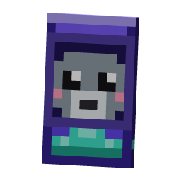](../content/dist/previews/vibe_cape.png) | `vibey:vibe_cape` | cape | rare | Vibe Cape / Vibe-Umhang | Classic Vibe purple with the pixel seal emblem and a teal hem (elytra painted to match). |
| [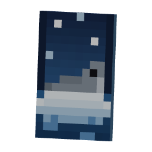](../content/dist/previews/ice_floe_cape.png) | `vibey:ice_floe_cape` | cape | rare | Ice Floe Cape / Eisscholle-Umhang | A tiny seal napping on its ice floe under the polar night. |
| [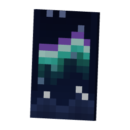](../content/dist/previews/aurora_cape.png) | `vibey:aurora_cape` | cape | epic | Aurora Cape / Polarlicht-Umhang | Animated (8-frame strip): northern lights rippling over snowy peaks. |
| [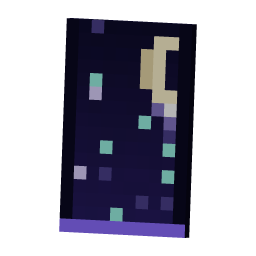](../content/dist/previews/pixel_stars_cape.png) | `vibey:pixel_stars_cape` | cape | rare | Pixel Stars Cape / Pixelsterne-Umhang | Animated (4 frames): twinkling stars, crescent moon, a shooting star. |
| [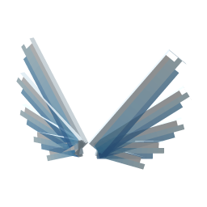](../content/dist/previews/crystal_wings.png) | `vibey:crystal_wings` | wings | legendary | Crystal Ice Wings / Kristalleisflügel | Translucent ice shards, a glint runs along them (animated texture); `idle` + `fly`. |
| [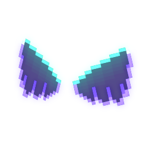](../content/dist/previews/neon_wings.png) | `vibey:neon_wings` | wings | epic | Neon Pixel Wings / Neon-Pixelflügel | Emissive pixel wings with a light pulse running along the edge; `idle` + `fly`. |
| [](../content/dist/previews/snowflake_orbit.png) | `vibey:snowflake_orbit` | aura | epic | Snowflake Orbit / Schneeflocken-Orbit | Five glowing snowflakes orbit the player and shed sprite snow. |
| [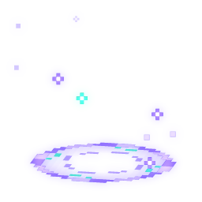](../content/dist/previews/ember_sparks.png) | `vibey:ember_sparks` | aura | epic | Ember Sparks / Glutfunken | Turning rune ring at the feet, purple/teal ember sprites rising. |
| [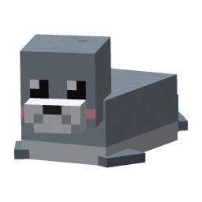](../content/dist/previews/seal_buddy.png) | `vibey:seal_buddy` | pet | epic | Seal Buddy / Robbenkumpel | The mascot (1:1 from `seal3d.ts`, no ice block) at `pet.scale` 0.4; looks around, wiggles, blinks; galumphing `walk`. |
| [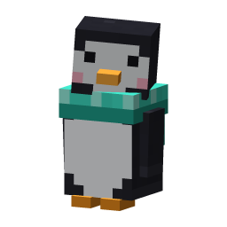](../content/dist/previews/pixel_penguin.png) | `vibey:pixel_penguin` | pet | rare | Pixel Penguin / Pixel-Pinguin | Tiny penguin with a teal scarf; blinks and flaps; waddling `walk`. |
| [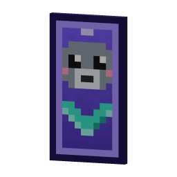](../content/dist/previews/seal_crest_shield.png) | `vibey:seal_crest_shield` | shield | rare | Seal Crest Shield / Robbenwappen-Schild | Purple field, seal emblem, teal chevron. |
| [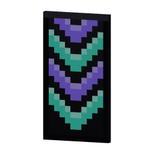](../content/dist/previews/vibe_chevron_shield.png) | `vibey:vibe_chevron_shield` | shield | common | Vibe Chevron Shield / Vibe-Sparren-Schild | Stacked purple and teal chevrons on black. |
| [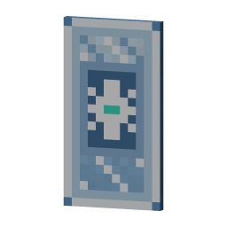](../content/dist/previews/glacier_shield.png) | `vibey:glacier_shield` | shield | rare | Glacier Shield / Gletscherschild | Faceted ice, frosted rim, snowflake emblem. |
| [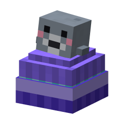](../content/dist/previews/seal_beanie.png) | `vibey:seal_beanie` | hat | rare | Seal Beanie / Robbenmütze | Knitted purple beanie, teal stripe, a little seal as the pom-pom (sways). Hidden under helmets. |
| [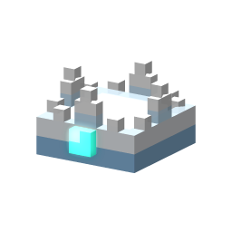](../content/dist/previews/ice_crown.png) | `vibey:ice_crown` | hat | epic | Ice Crown / Eiskrone | Translucent ice circlet with an emissive teal gem and occasional sparkle sprites. Hidden under helmets. |
| [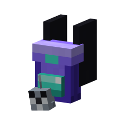](../content/dist/previews/seal_backpack.png) | `vibey:seal_backpack` | back | rare | Seal Backpack / Robben-Rucksack | Mini backpack with chest straps and a seal keychain that swings (`idle`, `walk`). |

### Emotes

| | Id | Rarity | Name (en / de) | What happens |
|---|---|---|---|---|
| [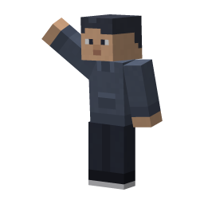](../content/dist/previews/wave.png) | `vibey:wave` | common | Wave / Winken | Big overhead wave with the right arm, head tilt. 2.2 s. |
| [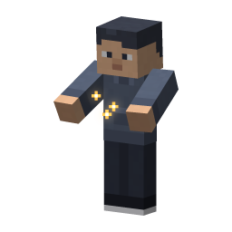](../content/dist/previews/clap.png) | `vibey:clap` | common | Clap / Klatschen | Four claps, each with a note-block snare and sparkle sprites at the hands. 2.2 s. |
| [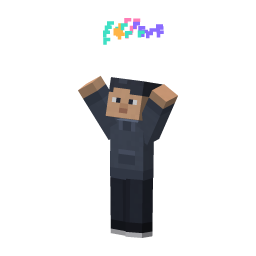](../content/dist/previews/cheer.png) | `vibey:cheer` | common | Cheer / Jubeln | Jump with both arms up, confetti sprite bursts (4 colours) + firework sounds. 2.4 s. |
| [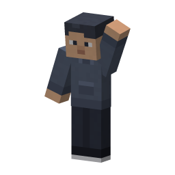](../content/dist/previews/vibe_dance.png) | `vibey:vibe_dance` | common | Vibe Dance / Vibe-Tanz | **Loop**, 120 bpm: sway, off-beat hops, alternating disco arms. |
| [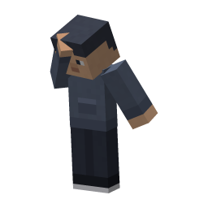](../content/dist/previews/facepalm.png) | `vibey:facepalm` | common | Facepalm / Facepalm | Hand to the face, slow head shake, villager "hmm". 2.8 s. |
| [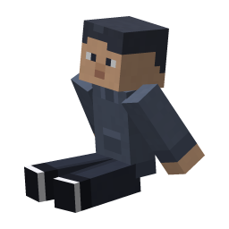](../content/dist/previews/sit.png) | `vibey:sit` | common | Sit / Hinsetzen | **Loop**: sit on the ground leaning back on the hands, looking around. |
| [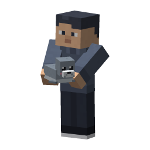](../content/dist/previews/seal_summon.png) | `vibey:seal_summon` | epic | Seal Summon / Robben-Beschwörung | Snow flurry, the seal **prop** pops into the arms (scale + visibility), wiggles, blinks, squeaks, poofs away. Uses the 3 embedded OGG sounds + vanilla sounds/particles. 4.2 s. |
| [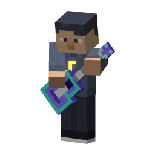](../content/dist/previews/guitar.png) | `vibey:guitar` | rare | Guitar Jam / Gitarrensolo | **Loop**: Vibe guitar **prop**, strumming arm, note-block guitar riff + `minecraft:note` particles. |
| [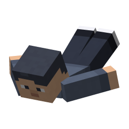](../content/dist/previews/seal_flop.png) | `vibey:seal_flop` | rare | Seal Flop / Robben-Plumps | Belly-flop like a seal, slap the "flippers", wiggle the "tail", get back up. Flop sounds. 3.4 s. |
| [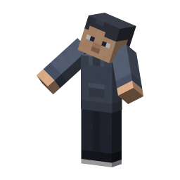](../content/dist/previews/shrug.png) | `vibey:shrug` | common | Shrug / Schulterzucken | Shoulders up, palms out, head tilt. 1.8 s. |

All emotes: `thirdPerson: true`, `stopOnMove: true`, `hideHeldItems: true`, animation `main`, start and end at
(or within a few degrees of) the rest pose so the 0.15 s fade is seamless. Loops have identical first/last keys.

## Polar Pals (premium collection, local only)

Eight new 3D, animated cosmetics in one arctic style, built like the starter set but in their own collection:
sources in `content/src/polar-pals/` (shared painting helpers in `_polar.mjs`), output in `content/dist/polar-pals/`
(`.vibey`, `previews/`, `thumbnails/`, `blockbench/`, its own `index.json`, a German test guide `README.md` and the
offline showcase page `polar-pals.html` with in-game screenshots). They are **not** part of the builtin set,
`content/dist/index.json` or the backend seed.

| Id | Slot | Rarity | What it does |
|---|---|---|---|
| `vibey:polar_seal` | pet | legendary | Shoulder-high chibi seal pup (`pet.scale` 1.2), 13 s `idle` (blink, head tilt, sit-up clap with hearts + squeak, roll), galumph `walk`, belly-scoot `sprint`, superman `glide`/`fly`, shy `sneak`, hop-clap `happy`, nap with 3D Zs in `idle_long`. |
| `vibey:polar_penguin` | pet | epic | Shoulder-high penguin chick (scale 0.95) in a knitted scarf: flaps, shows / tosses / gulps a fish, waddles, belly-slides in `sprint`, superman `glide`, flaps madly in `fly`, ducks in `sneak`, cheers in `happy`, dozes off in `idle_long`. |
| `vibey:polar_owl_wings` | wings | legendary | Feathered wings: arm/forearm/hand bones, coverts + alula layers, 5 secondaries and 5 primaries as bones; folded `idle`, flap + glide `fly` (feather sprites), soaring `glide`, tucked `sneak`; `offsetWhen` back. |
| `vibey:polar_aurora_wings` | wings | epic | Soft aurora veils: chains of 2 px emissive translucent segments with one continuous curtain texture (12-frame interpolated strip), flowing waves, `glide`, sparkle trail; `offsetWhen` back. |
| `vibey:polar_pompom_beanie` | hat | rare | Calm knitted beanie (three colours): purple crown, ribbed cuff, one clean snow-white pompom (boing, bounce, streams back). |
| `vibey:polar_igloo_backpack` | back | epic | Mini igloo on straps; a seal pup peeks out, blinks, waves and hides. |
| `vibey:polar_aurora_ring` | aura | epic | Soft northern lights: three thin curved ribbons of segments with drifting rays and alpha falloff, phase-shifted waves (fold, lift, lean, stretch), slow turn, orbiting crystal snowflakes, rising sparkles. |
| `vibey:polar_snowfall_cape` | cape | rare | HD (4×) 8-frame cape: the pals on an ice floe under a rippling aurora in falling snow. |

```sh
cd content
npm run build:polar                                  # = node tools/build.mjs --collection polar-pals
npm run check:blockbench -- --dir dist/polar-pals    # plugin validators + real Blockbench round trip
npm run push:polar                                   # push all into the running game (Creator mode, DEV items)
node tools/shot.mjs dist/polar-pals/polar_seal.vibey out.png "idle=5.2 + walk=1.2" --yaw 30,90   # quick pose check
```

New toolkit pieces (usable for any item): `b.texture(id, { hd: 4 })` HD textures (PNG k× the UV size, painters get
k× larger views; renderer and validator understand HD), `build.mjs --collection <folder>`, `tools/shot.mjs` (render
any pose/mix), `tools/push-to-game.mjs` (devlink push; finds `devlink.json` in `.minecraft`, the Vibe Launcher
instances `%APPDATA%\VibeLauncher\instances\<id>\minecraft` and `versions/*/run`; `--game-dir`, `--instance`),
`tools/showcase-html.mjs` (offline page with embedded screenshots) and the opt-in `ShowcaseGameTest`
(`VIBEYCLIENT_SHOWCASE=<folder>` + optional `VIBEYCLIENT_SHOWCASE_PLAN=content/src/polar-pals/showcase.json`, then
`./gradlew :fabric-1.21.11:runClientGameTest`; screenshots `sc_*.png`).

Design tricks: long `idle` loops tell a little story; eyelids, the fish, the peeking pup and the nap Zs rest
*inside* the model and are moved out by position offsets, so they vanish by themselves when another state takes
over (the Zs are additionally hidden by `idle` visibility events and shown by `idle_long`'s). The collection uses
the optional states of client 0.2.2 (`sprint`, `glide`, `idle_long`, `happy`, SPEC §5); on 0.2.1 the items still
play `idle`/`walk`/`fly`/`sneak` (no belly slide while sprinting, no nap). The aurora items share one painter
(`auroraTexel` in `_polar.mjs`): sine-sum rays that loop seamlessly in time and run continuously across segments,
alpha split over the two coplanar faces of each plane, `interpolate: true` strips. Both wings carry
`cosmetic.offsetWhen` for the `back` slot. `b.texture(id, { interpolate: true })` writes `animation.interpolate`.
The push script sends `thumbnails/<name>.png` with every item, so DEV items show their thumbnail in the wardrobe.

## Build

```sh
cd content
npm run build              # all items: dist/*.vibey + previews + thumbnails + index.json (~10 s)
npm run build -- seal      # only items whose file or id contains "seal" (others are left untouched)
npm run build:fast         # bundles only, no previews
npm run validate           # validate all dist/*.vibey against SPEC §5
node tools/validate.mjs some.vibey   # validate any bundle (also usable as a library: validate(buffer))
npm run synth              # re-synthesize content/sounds/*.ogg (needs ffmpeg with libvorbis on PATH)
npm run check:blockbench   # cross-check with the Blockbench plugin and the real Blockbench (see below)
```

The build is deterministic (seeded noise, fixed PNG encoder), so unchanged items produce byte-identical
`.vibey` files and the SHA-256 in `index.json` only changes when an item really changes. `content/.gitattributes`
keeps `.vibey`/`.json` files out of line-ending conversion for the same reason. Every bundle is validated during
the build; the build exits with code 1 if any bundle fails.

The writer emits the canonical form the Blockbench plugin (`blockbench/vibey.js`) writes: no empty `model` /
`animations`, bones depth-first (each root followed by its children), events sorted by time and then
particle < sound < visibility, defaults (`emissive: false`) omitted. That way a bundle imported into Blockbench and
exported again is the same bundle.

`dist/index.json` lists every item with `file`, `thumbnail`, `preview`, `size`, `sha256`, names, rarity, tags and a
suggested `sort` value (cosmetics by slot, then emotes) – handy for seeding the backend catalog
(`apps/api/seed/cosmetics/*.vibey`) and for embedding into the client (`assets/vibeyclient/builtin/*.vibey`).

## Adding a new item

1. Create `content/src/<slot>_<name>.mjs` (or `emote_<name>.mjs`) that default-exports a function returning a
   bundle. Start from a similar item. Minimal hat:

   ```js
   import { C, cosmetic } from "./_common.mjs";

   export default function () {
     const b = cosmetic("party_hat", {                       // id → vibey:party_hat, file → dist/party_hat.vibey
       name: { en: "Party Hat", de: "Partyhut" },
       description: { en: "…", de: "…" },
       tags: ["party"], rarity: "common",
       cosmetic: { slot: "hat", hideWithArmor: ["head"] },
     });
     const hat = b.bone("hat", { attach: "head", pivot: [0, 24, 0] });
     // box(from, size, painters, opts): integer sizes, box UV is packed into the "main" texture automatically
     hat.box([-2, 32, -2], [4, 6, 4], {
       sides: (img) => img.noisy(C.brand, 0.03, 1).row(2, C.teal),   // img = this face's pixels
       up: (img) => img.fill(C.teal),
       down: (img) => img.fill(C.brandDark),
     });
     b.anim("idle", 2, true).rot("hat", [[0, [0, 0, 0]], [1, [0, 0, 5]], [2, [0, 0, 0]]]); // catmullrom default
     return b;
   }
   ```

2. `npm run build -- party_hat`, then **look at** `dist/previews/party_hat.png` and `dist/thumbnails/party_hat.png`
   and iterate. `node tools/montage.mjs out.png a.png b.png …` tiles several PNGs for a quick side-by-side review.
3. Commit `src/…` together with the regenerated `dist/` files.
4. Optional but recommended for new models: `npm run check:blockbench -- --only party_hat --shots all` and look at
   `dist/blockbench/party_hat.png` – the item on the reference player in the real Blockbench.

### Cross-check with Blockbench (`npm run check:blockbench`)

`tools/check-blockbench.mjs` checks every `dist/*.vibey`:

1. **Node:** the plugin's validator (`Core.validateBundle`), the plugin's independent SPEC validator
   (`blockbench/test/spec-validator.js`) and the plugin's decompile → compile round trip.
2. **Real Blockbench** (installed desktop app, default `%LOCALAPPDATA%\Programs\Blockbench\Blockbench.exe`, override
   with `--blockbench <exe>`): started like the plugin's e2e test with an isolated temporary profile and remote
   debugging, the plugin is loaded from `blockbench/vibey.js`, every bundle is imported (the File > Import path) and
   exported again; the re-export must be semantically equal to the source (numbers within 1e-6, textures compared
   by decoded pixels – in practice the re-exports are byte-identical). Only the Blockbench process started by the
   script is closed afterwards.
3. **Screenshots** into `dist/blockbench/<name>.png`: front view from the player's front-left (like the previews)
   with the reference player visible (teal wrist band = right arm), emotes scrubbed to a mid-animation frame, plus
   `<name>_back.png` for capes, wings and back items. Default set: `vibe_cape`, `crystal_wings`, `seal_buddy`,
   `seal_beanie`, `seal_backpack`, `guitar`, `seal_summon`, `wave`; `--shots all` for every item, `--no-screenshots`,
   `--only a,b`, `--static` (Node checks only), `--keep-open`.

What to expect in the screenshots: everything is placed exactly as in the previews (wave/guitar/seal on the right
arm, wings and backpack on the back, hats on the head). Pets are shown at model scale at the feet (the client
applies `pet.scale` and the follow offset), capes and shields are texture-only (no model in Blockbench), and
Blockbench shows no particles.

Toolkit cheat sheet (`content/tools/vibey.mjs`, `content/src/_common.mjs`):

| Call | What it does |
|---|---|
| `cosmetic(id, meta)` / `emote(id, meta, { loop })` | new bundle with Vibe defaults (emote animation is always `main`) |
| `b.texture(id, { width, height, frames, frameTime })` | fixed-size texture (capes 64×32, shields 64×64) or animated strip; omit size for an auto-packed model texture |
| `tex.paint((img, frame) => …)` / `tex.region(w, h, painter)` | paint a whole frame / reserve a packed region (e.g. for sprites) |
| `b.bone(name, { parent, attach, pivot, rotation, emissive, translucent })` | bone; `attach` only on root bones |
| `bone.box(from, size, painters, { inflate, mirror })` | box-UV cube; painters per Blockbench face (`north`…`down`; `east` = +X = the player's right side; `sides`, `all`), called per animation frame |
| `b.anim(name, length, loop).rot/pos/scale(bone, [[t, v, interp?]…], interp)` | keyframes (default `catmullrom`; `"linear"` for constant spins) |
| `a.particle(t, {…})`, `a.sound(t, id, { volume, pitch })`, `a.visible(t, bone, bool)` | events |
| `b.locator(name, bone, pos)`, `b.sprite(id, texture, region)`, `b.sound(id, oggBytes)` | locators, sprite particles, embedded sounds |
| `aim(from, to)` | arm/leg rotation that points a limb hanging from `from` at `to` (emotes, props) |
| `addSeal(b, { prefix, attach, o })` (`_seal.mjs`) | the Vibe seal model (used by Seal Buddy and Seal Summon) |
| `img.noisy / fill / rect / row / col / px / stamp / line / border / blend` | pixel painting helpers (`tools/canvas.mjs`) |

## How the toolkit reads SPEC §5 (interpretations other parts should match)

The renderer in `tools/render/renderer.mjs` implements these rules; the previews are what a spec-conformant client
should show.

- **Coordinates:** `.vibey` files, item scripts and the builder all use **Blockbench space** (SPEC §5 "Coordinate
  convention"): pixels, origin at the feet, +Y up, the player faces north (−Z), the **right arm is at +X** (pivot
  `[5, 22, 0]`, `PIVOTS` / `SHOULDER` in the toolkit). What Blockbench shows is what is written. The renderer
  converts to vanilla model space like Blockbench's Modded Entity exporter and the client: `x' = −x`,
  `y' = 24 − y`, `z' = z`; rotations (rest + keyframes) `xRot = −rx`, `yRot = −ry`, `zRot = rz` (degrees →
  radians, vanilla `ModelPart` order Z·Y·X); position keyframes `(−x, −y, z)`; bone matrix =
  `T(pivot offset + position) · R · S`. Model space → world (player yaw 0, facing +Z) is `(x, 24 − y, −z)`, so
  seen from the front the right arm is on the viewer's left. Particle `velocity` and locator positions use the same
  handedness (`spread` is a symmetric extent). Box-UV face names follow Blockbench too: in `bone.box` painters
  `east` is the +X side (the player's right side, the first `d`-wide column of the box layout), `west` the −X side.
  Resulting intuition for keyframes: arm/leg `rx > 0` swings forward, right arm `rz > 0` / left arm `rz < 0`
  raises it sideways, head `rx > 0` looks up and `ry > 0` turns to the player's left, `root` `rx < 0` tips the
  whole player forward, root position `+x` is to the player's right, `+y` up and `−z` forward. `aim(from, to)`
  computes arm rotations from Blockbench-space points.
- **History:** the starter set was first written against an older reading (`x' = x`, right arm at −X). It was
  converted by mirroring every X position (pivots, cubes with from/to swapped, locators, position keyframes,
  particle velocities) while keeping all rotations, which renders exactly the same in game; the conversion was
  verified by byte-identical previews and thumbnails before and after.
- **Pivots, cubes, locators** use absolute model coordinates (like Blockbench), also for child bones. A root bone
  attached to a player part is positioned in that part's space relative to the part pivot (spec table).
- **Box UV** is the vanilla `ModelPart` cube layout (`texOffs`), including the vanilla orientation of each face.
  The starter set only uses box UV and one texture per bundle (`model.texture`), so no per-face UV ambiguity.
  Thin planes are cubes with a 0 size on one axis.
- **Player bones in emotes** (`head`, `body`, arms, legs) are siblings under `root`, like vanilla: rotating `body`
  does not move the head or arms. `root` pivots at the feet `[0, 0, 0]`. Values are offsets added to the rest pose.
- **Interpolation (Blockbench's rules, ported from Blockbench 5.2's `BoneAnimator.interpolate`):** segment A→B runs
  from `A.v` to `B.pre ?? B.v`; `A.i == "step"` holds A; A and B linear (or B step) → linear; A **or** B
  `catmullrom` → Catmull-Rom with the neighbouring keys as control points (the end point is duplicated when there is
  no neighbour or the key is split with `pre`); in looping animations with ≥ 3 keys Blockbench takes the missing
  neighbours from the other end (`keys[n−2]` before the first segment, `keys[1]` after the last), which keeps
  seamless loops smooth – the value never interpolates across the loop end. Before the first key its `pre ?? v` is
  held, after the last key its `v`. `bezier` is treated as linear (not used by the starter set). The builder's
  default interpolation is `catmullrom`.
- **Visibility:** a bone's visibility at time `t` is the value of its last `visibility` event with `event.t ≤ t`,
  default visible; hiding a bone hides its children. Items that start hidden have an event at `t = 0`.
- **Animated textures:** `width`/`height` are the size of **one frame** (the UV space); the PNG is a vertical
  strip `height × frameCount` tall; `frames` are indices into the strip, `frameTime` is in ticks (like `.mcmeta`).
  The model texture can be animated too (Crystal/Neon wings).
- **Particles:** `spread` (± half-extent, blocks), `velocity` (blocks per tick), `gravity` (blocks per tick², positive
  = falls, negative = rises), `size` (blocks), `lifetime` (seconds); spawned at the locator's current world position.
  Sprite particles use `sprites[].uv` (texture pixels). Bursts that should fan out are written as several events
  with different velocities, so they look right even if a client adds no randomness of its own.
- **Pets:** model built around the pet's own feet at the origin, facing north; `cosmetic.pet.scale` scales the whole
  model about the origin; `follow: "ground"` means "walk next to the player" (the client chooses the offset and the
  lag). The previews place pets 20 px to the player's right (+X).
- **Capes/Shields** are pure textures in the vanilla 64×32 cape layout (incl. a matching elytra region) and 64×64
  shield layout; the previews use the vanilla cape model (2 px behind the body, ~6° tilt) and the vanilla shield
  model.
- **Emote props** are bones attached to `root`, `body` or an arm; empty helper bones (`right_hand`, `hands`) carry
  locators so no locator has to reference a player bone directly (the validator also accepts player bones).
- **Sounds:** vanilla ids are plain `minecraft:` sound events; embedded sounds (`seal_summon`: `chime`, `pop`,
  `squeak`) are mono OGG Vorbis, synthesized in `tools/synth.mjs`.

## License

The starter set (`content/src`, `content/dist`, `content/sounds`, `content/audit`) is artwork by Vibe Craft Studios,
all rights reserved (`NOTICE`, [ASSETS-POLICY.md](https://github.com/vibec-studios/.github/blob/main/ASSETS-POLICY.md)); only the tools in `content/tools/` are Apache-2.0 code. Forks must make
their own content.
