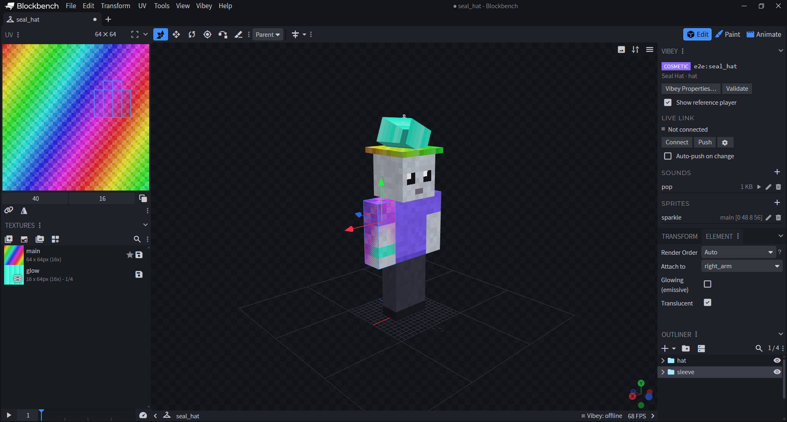

# The `.vibey` format, for creators

Every Vibey Client cosmetic and emote is **one `.vibey` file**: plain UTF-8 JSON with everything inside it (model,
textures, animations, particles, sounds). The game loads it directly, the [Blockbench plugin](BLOCKBENCH.md) writes
it, and the Vibe backend stores it unchanged.

Most creators never touch the JSON: model and animate in Blockbench, export, done. This page is for when you want to
know what the plugin writes, read a bundle, generate one from code (like the [starter set](CONTENT.md) does) or
understand a validation message.

> This is a friendly guide. The normative reference is [SPEC §5](SPEC.md#5-the-vibey-asset-format-v1); if the two
> ever disagree, SPEC wins.

Contents: [File layout](#file-layout) · [Metadata](#metadata) · [Cosmetics and slots](#cosmetics-and-slots) ·
[Emotes](#emotes) · [Coordinates](#coordinates) · [Model](#model-bones-and-cubes) · [Textures](#textures) ·
[Animations](#animations) · [Events: particles, sounds, visibility](#events-particles-sounds-visibility) ·
[Limits and validation](#limits-and-validation) · [Examples](#examples)

## File layout

```jsonc
{
  "format": "vibey",            // always "vibey"
  "formatVersion": 1,           // always 1
  "kind": "cosmetic",           // "cosmetic" or "emote"
  "id": "yourname:party_hat",   // namespace:path
  "name": { "en": "Party Hat", "de": "Partyhut" },
  "description": { "en": "…", "de": "…" },   // optional
  "author": "You",
  "tags": ["party"],
  "rarity": "common",

  "cosmetic": { … },            // only for kind = cosmetic
  "emote": { … },               // only for kind = emote

  "textures": [ … ],            // PNGs, base64
  "model": { … },               // bones, cubes, locators
  "animations": { … },          // keyframes + events
  "sprites": [ … ],             // optional: particle sprites cut from a texture
  "sounds": [ … ]               // optional: embedded OGG sounds
}
```

Unknown fields are ignored, so newer files still load in older clients (they just skip what they don't know).
The same goes for unknown values where a fallback exists: an unknown event `type` or animation name is skipped, an
unknown interpolation `i` plays as `linear`, an unknown `attach` point falls back to `body` (emotes: `root`) –
each with a validator warning. If a file really needs a newer game client, say so with `minClientVersion`.

## Metadata

| Field | Required | Notes |
|---|---|---|
| `id` | yes | `namespace:path`, lowercase `a-z 0-9 _ . -` (path may also contain `/`), max 128 characters. The `vibey:` namespace is for official items – use your own, e.g. your name. A live-link push with the same id replaces the previous version. |
| `name` | yes | `{ "en": …, "de": … }`. English is required. German is recommended (validators warn without it); the game falls back to English. |
| `description` | no | Same shape as `name`. |
| `author`, `tags` | no | Shown in the wardrobe; tags help search. |
| `rarity` | yes | `common`, `rare`, `epic` or `legendary`. Only a coloured label – everything is free. Fields like `price` or `cost` are **rejected**. |
| `minClientVersion` | no | Lowest Vibey Client version that can show the item, e.g. `"0.3.0"`. Older clients list it greyed out with *Update Vibey Client* instead of loading it (same for a newer `formatVersion`). The catalog can also set it per item. |

## Cosmetics and slots

```jsonc
"cosmetic": {
  "slot": "pet",                          // cape | wings | aura | pet | shield | hat | back
  "hideWithArmor": ["head"],              // optional: hide while this armor piece is worn (head|chest|legs|feet)
  "pet":    { "follow": "ground", "scale": 0.4 },   // pets only
  "offsetWhen": [                         // optional (client 0.2.2+): move out of the way of another slot
    { "slot": "back", "offset": [0, 1, 8], "rotation": [0, 0, 0] }
  ],
  "cape":   { "texture": "cape" },        // capes only: texture-only cape
  "shield": { "texture": "shield" }       // shields only: texture-only shield
}
```

A player wears at most one item per slot.

**Making room for other slots (`offsetWhen`, client 0.2.2+):** each rule `{ "slot", "offset"?, "rotation"? }` moves
the item's **root bones** while an item is worn (and shown) in that other slot – offset in pixels like a position
keyframe, rotation in degrees like a rotation keyframe, eased in and out. Use it so wings move back when a backpack
is worn: `"offsetWhen": [{ "slot": "back", "offset": [0, 1, 8] }]`. Up to 8 rules, offsets within ±64 px, rotations
within ±360°, never the item's own slot. Older clients ignore the field; the Blockbench plugin keeps it on import /
export (edit it in the `.vibey` or keep it from an imported file).

| Slot | Usual attach | Model | Notes |
|---|---|---|---|
| `cape` | `body` | optional | Simplest form: just a texture in the vanilla **64×32 cape layout** (`cape.texture`), drawn with the vanilla cape model (and on the elytra). Or a full model. |
| `wings` | `body` | required | Animations `idle` and `fly` (elytra / creative flying) are worth making; `glide` (elytra) is optional. Use `offsetWhen` to make room for a backpack. |
| `aura` | `world` | required | Rings, orbiting things, particles. Usually `emissive`. |
| `pet` | `world` | required | Build it around its own feet at the origin, facing north. `pet.follow`: `ground` (default, walks beside you), `shoulder_right`, `shoulder_left` or `float`. `pet.scale` (> 0, max 8) scales the whole model; the client picks the spot beside you and lets it follow with a little lag. |
| `shield` | `left_arm` | optional | Simplest form: a texture in the vanilla **64×64 shield layout** (`shield.texture`), drawn with the vanilla shield model. |
| `hat` | `head` | required | Usually `"hideWithArmor": ["head"]`. |
| `back` | `body` | required | Backpacks, quivers, … Usually `"hideWithArmor": ["chest"]` if it would clip. |

## Emotes

```jsonc
"emote": {
  "animation": "main",     // which entry of "animations" plays
  "loop": false,           // must match the animation's "loop"
  "thirdPerson": true,     // switch the camera to third person while playing
  "stopOnMove": true,      // walking cancels the emote
  "hideHeldItems": true
}
```

An emote animates the player's own body. Its animation can key these **player bones** by name:

| Bone | Pivot (Blockbench) | |
|---|---|---|
| `root` | `[0, 0, 0]` (feet) | moves / rotates the whole player |
| `head` | `[0, 24, 0]` | |
| `body` | `[0, 24, 0]` | |
| `right_arm` | `[5, 22, 0]` | |
| `left_arm` | `[-5, 22, 0]` | |
| `right_leg` | `[1.9, 12, 0]` | |
| `left_leg` | `[-1.9, 12, 0]` | |

The six parts are children of `root` and **siblings of each other**, like vanilla: rotating `body` does not move
the head or the arms. Values are offsets from the normal standing pose. The skin's outer layer (hat, jacket,
sleeves, pants) follows its part automatically.

**Props** (a guitar, a seal, a sign) are normal model bones attached to a player part: `"attach": "right_arm"` makes
them move with the right arm. Your own bones must not use the player bone names.

Emotes fade in and out over 0.15 s. Start and end near the standing pose so the fade looks seamless. For a pose that
should stay until the player moves, use `"loop": false` with `"hold": true` on the animation.

## Coordinates

Everything is in **Blockbench space**, exactly what Blockbench shows on its player model:

- Units are pixels, 16 = one block.
- Origin at the player's feet, **+Y up**.
- The player faces **north (−Z)**. So the player's **right arm is at +X**, the left arm at −X.



Vanilla player cubes in this space, handy for placing things:

| Part | Cube from → to |
|---|---|
| head | `[-4, 24, -4]` → `[4, 32, 4]` |
| body | `[-4, 12, -2]` → `[4, 24, 2]` |
| right arm | `[4, 12, -2]` → `[8, 24, 2]` |
| left arm | `[-8, 12, -2]` → `[-4, 24, 2]` |
| right leg | `[-0.1, 0, -2]` → `[3.9, 12, 2]` |
| left leg | `[-3.9, 0, -2]` → `[0.1, 12, 2]` |

The rule: **what you see on the reference player in Blockbench is what the game renders.** You never convert
anything yourself. (For the curious: the game maps to Minecraft model space with `x' = −x`, `y' = 24 − y`, `z' = z`
like Blockbench's Modded Entity exporter; see SPEC §5.)

Rotation intuition for keyframes (degrees): an arm or leg with `x > 0` swings forward; right arm `z > 0` / left arm
`z < 0` lifts it sideways; head `x > 0` looks up, `y > 0` turns to the player's left; `root` `x < 0` tips the whole
player forward. Root position `+x` is to the player's right, `+y` up, `−z` forward.

## Model: bones and cubes

```jsonc
"model": {
  "texture": "main",                 // default texture for cubes
  "bones": [
    {
      "name": "hat",
      "parent": null,                // null = root bone
      "attach": "head",              // root bones only, see below
      "pivot": [0, 24, 0],
      "rotation": [0, 0, 0],         // degrees, rest pose
      "cubes": [
        { "from": [-4, 32, -4], "to": [4, 36, 4], "uv": { "box": [0, 0] } }
      ],
      "emissive": false,             // true = glows (full bright)
      "translucent": false           // true = semi-transparent pixels blend
    },
    { "name": "pompom", "parent": "hat", "pivot": [0, 36, 0], "cubes": [ … ] }
  ],
  "locators": {
    "tip": { "bone": "pompom", "position": [0, 38, 0] }
  }
}
```

**Attach points** (root bones only, required there):

| `attach` | Follows |
|---|---|
| `head`, `body`, `right_arm`, `left_arm`, `right_leg`, `left_leg` | that body part, including walking, sneaking and emote animations |
| `root` | the player's position and body rotation, but not part animations |
| `world` | the feet position and body rotation, smoothed (pets, auras) |

Place the bone where it should be on the standing player; the game moves it with the part.

**Bones:** names are unique; a child bone (`parent` set) follows its parent and ignores `attach`. Pivots, cube
`from`/`to` and locator positions are all **absolute** model coordinates (not relative to the parent), like in
Blockbench.

**Cubes:**

- `from` / `to`: opposite corners. A size of 0 on one axis makes a flat plane.
- `inflate`: grows the cube on all sides without changing its UVs (like the skin's outer layer).
- Optional `pivot` + `rotation` per cube, and an optional `name` (editor only).
- **Box UV** (default in Blockbench): `"uv": { "box": [u, v] }` – the classic Minecraft layout at that texture
  offset. `"mirror": true` mirrors it.
- **Per-face UV**: `"uv": { "north": [u1, v1, u2, v2], "east": …, "south": …, "west": …, "up": …, "down": … }`. A face
  can also be `{ "uv": [u1, v1, u2, v2], "texture": "other" }`. **Faces you leave out are not drawn.**
- Texture lookup: face `texture` → cube `texture` → `model.texture` → the first texture.

**Locators** are named points for particles and sounds. `bone` is a model bone, or in emotes also a player bone; the
locator follows that bone's animation.

## Textures

```jsonc
"textures": [
  { "id": "main", "width": 64, "height": 32, "png": "<base64 PNG>" },
  { "id": "glow", "width": 16, "height": 16, "png": "<base64 PNG, 16×64>",
    "animation": { "frameTime": 2, "frames": [0, 1, 2, 3], "interpolate": false } }
]
```

- `width` / `height` are the **UV size of one frame**, the space your UVs are measured in.
- **HD:** the PNG may be larger with the same aspect ratio (e.g. a 128×64 PNG for a 64×32 UV space).
- **Animated textures** work like `.mcmeta`: a vertical strip of frames, `frameTime` in ticks (20 per second),
  `frames` = order (default: all frames top to bottom), optional `interpolate: true` blends between frames. Model
  textures can be animated too (the Crystal Ice Wings' glint is one).
- Transparency: fully transparent pixels are cut out; partly transparent pixels need `translucent: true` on the bone.

## Animations

```jsonc
"animations": {
  "idle": {
    "length": 2.0,                       // seconds
    "loop": true,
    "bones": {
      "pompom": {
        "rotation": [ { "t": 0, "v": [0, 0, 0] }, { "t": 1, "v": [0, 0, 8], "i": "catmullrom" }, { "t": 2, "v": [0, 0, 0] } ],
        "position": [ … ],               // pixels, offset from rest
        "scale":    [ … ]                // factors, 1 = normal
      }
    },
    "events": [ … ]
  }
}
```

**Names that mean something on cosmetics:** `idle` (always plays), `walk` (blended in by walking speed; pets: by
their own movement), `fly` (elytra / creative flying – for wings), `sneak`, and – optional, client 0.2.2+ –

| Name | Plays while | If the bundle has none |
|---|---|---|
| `sprint` | the player sprints (pets: belly slide, fast scoot) | `walk` |
| `glide` | elytra flight, or falling for a moment (wings spread, pets "superman") | `fly` (elytra), nothing (falling) |
| `idle_long` | the player stood still ~10 s (pets nap) | `idle` |
| `happy` | the owner plays an emote (pets cheer) | the lower states / `idle` |

They blend by priority `glide` > `fly` > `sprint` > `walk` > `sneak` > `happy` > `idle_long` > `idle`; the weights
always add up to 1 (a moving pet of a flying player plays `fly`, not `walk` + `fly`). The optional states start from
their first frame when they begin; `idle`/`walk`/`fly`/`sneak` run on a shared clock. Older clients ignore the new
names, so keep `idle`/`walk`/`fly` good on their own. An empty animation (no keyframes, no events) counts as missing.
Other names are not played automatically on cosmetics. Events of `idle` always run; events of the other states run
while that animation is the main one (weight ≥ 50 %), and visibility events follow the strongest playing animation
that has some (else `idle`). Emotes play the animation named in `emote.animation` (the plugin always uses `main`).

**Soft light:** bones that are both `emissive` and `translucent` render as a soft glow (full-bright, no face
shading, no depth writes) and, on 1.21.11 and 26.1, without Minecraft's usual 0.1 alpha cutoff – alpha gradients fade out
smoothly to 0, so aurora veils, glows and mist have no hard edges. Plain `translucent` bones keep their lighting and
also fade smoothly (only fully transparent pixels are dropped).

**Keyframes:** `t` = time in seconds, `v` = value, `i` = interpolation of the segment that starts at this key:

| `i` | Between this key and the next |
|---|---|
| `linear` (default) | straight line |
| `catmullrom` | smooth curve through the neighbouring keys (used if either end is `catmullrom`) |
| `step` | holds this value until the next key |
| `bezier` | accepted, played as linear |

A key may carry `pre`, the value arriving at `t` from the previous key, to make a jump (Blockbench's split
keyframes). Before the first key and after the last, the value is held; a looping animation never blends across the
loop end, so make the first and last keys equal for a seamless loop. Channels you don't key stay at rest. Molang
expressions are not supported – use numbers.

## Events: particles, sounds, visibility

Events live in an animation's `events` list and fire at time `t`.

```jsonc
"events": [
  // vanilla particle at a locator
  { "t": 0.5, "type": "particle", "particle": "minecraft:heart", "locator": "tip",
    "count": 3, "spread": [0.2, 0.2, 0.2], "velocity": [0, 0.05, 0] },

  // sprite particle: a small picture cut from one of your textures
  { "t": 0.5, "type": "particle", "sprite": "star", "locator": "tip", "count": 4,
    "lifetime": 0.8, "size": 0.15, "spread": [0.3, 0.3, 0.3], "velocity": [0, 0.08, 0],
    "gravity": -0.01, "emissive": true },

  // vanilla sound event, or the id of an embedded sound
  { "t": 0.0, "type": "sound", "sound": "minecraft:entity.player.levelup", "volume": 1, "pitch": 1 },
  { "t": 1.0, "type": "sound", "sound": "pop", "locator": "tip" },

  // hide or show a model bone (and its children) from this time on
  { "t": 1.2, "type": "visibility", "bone": "guitar", "visible": false }
],
"sprites": [ { "id": "star", "texture": "main", "uv": [0, 48, 8, 56] } ],   // uv = u1 v1 u2 v2 in texture pixels
"sounds":  [ { "id": "pop", "ogg": "<base64 OGG Vorbis>" } ]
```

| Particle field | Unit |
|---|---|
| `spread` | blocks (± extent around the locator; the client adds a little randomness inside it) |
| `velocity` | blocks per tick, Blockbench handedness (+X = the player's right) |
| `gravity` | blocks per tick², positive falls, negative rises (sprites) |
| `size` | blocks (sprites) |
| `lifetime` | seconds (sprites) |

- `particle` must be a namespaced id (`minecraft:heart`) unless `sprite` is set.
- Sounds: any namespaced sound event, or the `id` of an entry in `sounds` (OGG Vorbis, mono sounds are positional).
  Optional `locator` places the sound.
- Visibility: a bone's state is that of its last visibility event at or before `t` (default visible). Props that
  should appear later get `"visible": false` at `t = 0` – that's how Seal Summon makes the seal pop in.
- For a burst that fans out, write several events with different velocities.

## Limits and validation

The game, the backend and the Blockbench plugin check the same rules. A bundle that fails is not loaded, and the
message says why (in Blockbench: *Vibey > Validate bundle*; on the command line: `node content/tools/validate.mjs
my.vibey`).

| Rule | Limit |
|---|---|
| File size | ≤ 2 MiB |
| `format` / `formatVersion` | `"vibey"` / `1` |
| `id` | `^[a-z0-9_.-]+:[a-z0-9_./-]+$`, ≤ 128 chars |
| `kind`, `slot`, `attach`, `rarity` | one of the listed values |
| References | every texture, bone, parent, locator, sprite and sound that is referenced must exist; no parent cycles; bone names unique |
| Textures | PNG, ≤ 512×512 (animated strips ≤ 512 wide, ≤ 4096 high) |
| Model | ≤ 256 bones, ≤ 2048 cubes |
| Sounds | OGG Vorbis, ≤ 512 KiB each |
| Pets | `pet.scale` > 0 and ≤ 8 |
| Model required | for wings, aura, pet, hat, back (capes and shields can be texture-only) |
| Emotes | `emote.animation` exists; own bones don't use player bone names |
| No prices | `price`, `cost`, `prices` are rejected |

Warnings (the bundle still loads): an unknown `hideWithArmor` value, a cube without faces, a texture that looks like
a strip but has no `animation`, a root bone without (or with an unknown) `attach`, an unknown interpolation or event
type.

Bundles for a newer client (`minClientVersion` above the running version, `formatVersion` > 1) are not errors: the
game lists them greyed out with *Update Vibey Client*. Test files that combine unusual features live in
`content/audit/` (built by `content/tools/build-audit.mjs`, checked by `AuditBundlesGameTest`).

## Examples

### A texture-only cape

The smallest useful cosmetic: one 64×32 PNG in the vanilla cape layout, no model.

```json
{
  "format": "vibey", "formatVersion": 1, "kind": "cosmetic",
  "id": "yourname:stripes_cape",
  "name": { "en": "Stripes Cape", "de": "Streifen-Umhang" },
  "author": "You", "tags": ["cape"], "rarity": "common",
  "cosmetic": { "slot": "cape", "cape": { "texture": "cape" } },
  "textures": [ { "id": "cape", "width": 64, "height": 32, "png": "iVBORw0KGgo…" } ]
}
```

### A hat with a swaying pom-pom

```json
{
  "format": "vibey", "formatVersion": 1, "kind": "cosmetic",
  "id": "yourname:pompom_hat",
  "name": { "en": "Pom-pom Hat", "de": "Bommelmütze" },
  "author": "You", "tags": ["hat", "winter"], "rarity": "rare",
  "cosmetic": { "slot": "hat", "hideWithArmor": ["head"] },
  "textures": [ { "id": "main", "width": 64, "height": 32, "png": "iVBORw0KGgo…" } ],
  "model": {
    "texture": "main",
    "bones": [
      { "name": "hat", "parent": null, "attach": "head", "pivot": [0, 24, 0],
        "cubes": [ { "from": [-4, 28, -4], "to": [4, 33, 4], "inflate": 0.6, "uv": { "box": [0, 0] } } ] },
      { "name": "pompom", "parent": "hat", "pivot": [0, 34, 0],
        "cubes": [ { "from": [-2, 34, -2], "to": [2, 38, 2], "uv": { "box": [0, 13] } } ] }
    ]
  },
  "animations": {
    "idle": { "length": 3, "loop": true, "bones": { "pompom": { "rotation": [
      { "t": 0, "v": [0, 0, 0], "i": "catmullrom" }, { "t": 1.5, "v": [0, 0, 6], "i": "catmullrom" },
      { "t": 3, "v": [0, 0, 0], "i": "catmullrom" } ] } } }
  }
}
```

### A wave emote with sparkles

```json
{
  "format": "vibey", "formatVersion": 1, "kind": "emote",
  "id": "yourname:hello",
  "name": { "en": "Hello", "de": "Hallo" },
  "author": "You", "tags": ["wave"], "rarity": "common",
  "emote": { "animation": "main", "loop": false, "thirdPerson": true, "stopOnMove": true, "hideHeldItems": true },
  "textures": [ { "id": "main", "width": 16, "height": 16, "png": "iVBORw0KGgo…" } ],
  "model": {
    "bones": [ { "name": "right_hand", "parent": null, "attach": "right_arm", "pivot": [5, 22, 0], "cubes": [] } ],
    "locators": { "hand": { "bone": "right_hand", "position": [6, 11, 0] } }
  },
  "sprites": [ { "id": "star", "texture": "main", "uv": [0, 0, 3, 3] } ],
  "animations": {
    "main": {
      "length": 1.6, "loop": false,
      "bones": {
        "right_arm": { "rotation": [
          { "t": 0, "v": [0, 0, 0], "i": "catmullrom" },
          { "t": 0.3, "v": [0, 0, 150], "i": "catmullrom" },
          { "t": 0.6, "v": [0, 0, 120], "i": "catmullrom" },
          { "t": 0.9, "v": [0, 0, 150], "i": "catmullrom" },
          { "t": 1.6, "v": [0, 0, 0], "i": "catmullrom" } ] },
        "head": { "rotation": [ { "t": 0, "v": [0, 0, 0] }, { "t": 0.4, "v": [0, 0, -8] }, { "t": 1.6, "v": [0, 0, 0] } ] }
      },
      "events": [
        { "t": 0.3, "type": "particle", "sprite": "star", "locator": "hand", "count": 4, "lifetime": 0.6,
          "size": 0.12, "spread": [0.2, 0.2, 0.2], "velocity": [0, 0.04, 0], "emissive": true },
        { "t": 0.3, "type": "sound", "sound": "minecraft:entity.experience_orb.pickup", "volume": 0.5, "pitch": 1.4 }
      ]
    }
  }
}
```

The `right_hand` bone has no cubes; it only carries the locator so the sparkles follow the waving hand. Real
starter items to learn from: [`content/src/`](../content/src/) (the code that builds them) and
[`content/dist/`](../content/dist/) (the bundles) – see [CONTENT.md](CONTENT.md).

## Trying it out

- **Live:** turn on *Creator mode* in the game (*Vibey menu → Blockbench link*) and push from Blockbench – the item
  shows up as a local *DEV* item, equipped or played right away. See [BLOCKBENCH.md → Live link](BLOCKBENCH.md#live-link).
- **Validate:** `node content/tools/validate.mjs my.vibey`, or *Vibey > Validate bundle* in Blockbench.
